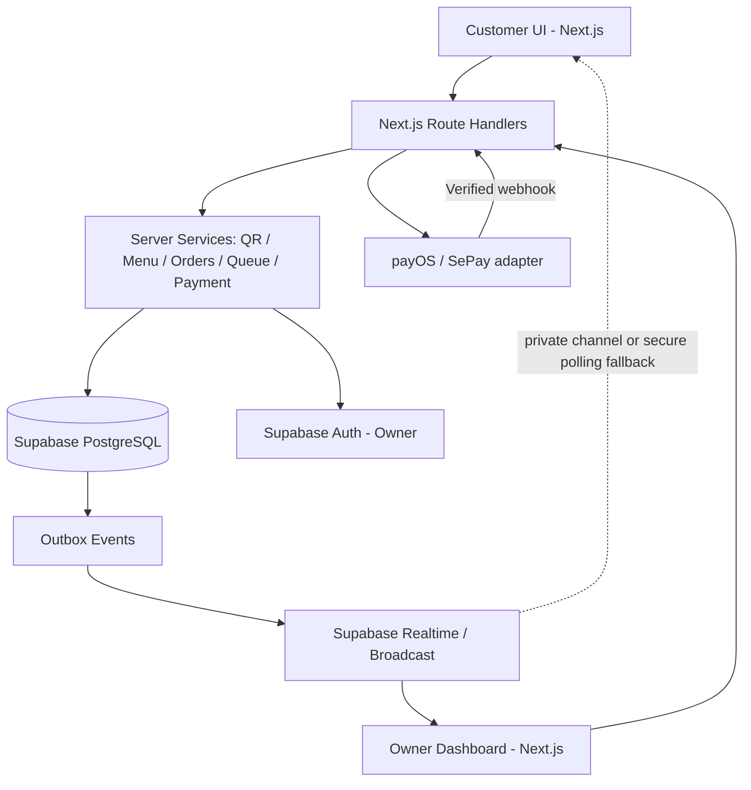

# ARCHITECTURE — Kiến trúc kỹ thuật, database, API & FIFO

**Chủ trì:** Codex. **Phạm vi:** single-store MVP (thiết kế bảng vẫn có `store_id` để mở rộng sau). **Nguyên tắc:** frontend không được quyết định thanh toán, giá, số FIFO hoặc trạng thái đơn.

## 1. Sơ đồ hệ thống



### Module boundaries
- **Next.js Server:** HTTP auth, validation Zod, orchestration, API response.
- **PostgreSQL:** nguồn sự thật, transactions, constraints, FIFO ticket counter, locks, audit.
- **Supabase Auth:** chỉ Owner; xác định `user_id` và mapping `store_id`.
- **Supabase Realtime:** thông báo owner và guest đúng quyền, có re-fetch khi reconnect.
- **Payment Provider:** tạo yêu cầu và xác nhận kết quả thông qua webhook **được kiểm chữ ký**.
- **Customer UI:** chỉ hiển thị và gọi API; không gửi giá tin cậy, không cập nhật state bằng quyền owner.

Không dùng queue in-memory, `localStorage` làm nguồn sự thật, `SELECT MAX(ticket_no)+1`, hoặc timestamp thiết bị khách để tính FIFO.

## 2. Cấu trúc dự án (file ownership rõ ràng)

```text
src/
├── app/
│   ├── (customer)/
│   │   ├── q/[code]/page.tsx                 # Gemini
│   │   └── order/[publicId]/page.tsx         # Gemini
│   ├── (owner)/
│   │   ├── login/page.tsx                    # Gemini
│   │   └── dashboard/page.tsx                # Gemini
│   ├── api/                                  # Codex
│   │   ├── public/qr/[code]/route.ts
│   │   ├── public/table-sessions/verify/route.ts
│   │   ├── public/menu/route.ts
│   │   ├── public/orders/route.ts
│   │   ├── public/orders/[id]/route.ts
│   │   ├── public/payments/[id]/route.ts
│   │   ├── webhooks/payments/[provider]/route.ts
│   │   ├── owner/orders/route.ts
│   │   ├── owner/queue/claim-next/route.ts
│   │   ├── owner/orders/[id]/ready/route.ts
│   │   ├── owner/orders/[id]/complete/route.ts
│   │   ├── owner/tables/route.ts
│   │   ├── owner/tables/[id]/sessions/route.ts
│   │   ├── owner/table-sessions/[id]/settle/route.ts
│   │   ├── owner/menu/route.ts
│   │   ├── owner/menu/[id]/route.ts
│   │   ├── owner/qr-codes/route.ts
│   │   └── owner/settings/route.ts
│   └── globals.css                          # Gemini (file ownership exclusive)
├── components/
│   ├── ui/                                   # Gemini - shadcn
│   ├── customer/                             # Gemini
│   └── owner/                                # Gemini
├── features/
│   ├── customer/api-client.ts                # Codex (API adapter)
│   └── owner/api-client.ts                   # Codex (API adapter)
├── server/                                   # Codex
│   ├── auth/
│   ├── db/
│   ├── menu/
│   ├── qr/
│   ├── orders/
│   ├── queue/
│   ├── payments/
│   │   ├── gateway.ts
│   │   ├── payos.ts
│   │   └── sepay.ts
│   ├── table-sessions/
│   ├── realtime/
│   └── audit/
├── types/contracts/                          # Codex owns, Gemini imports read-only
├── lib/mocks/                                # Gemini only
└── lib/supabase/                             # Codex
supabase/migrations/                         # Codex
tests/{unit,integration,e2e,load}/             # Codex API/tests; Gemini UI tests under tests/ui/
public/                                      # Gemini images/icons; no payment secrets
```

**Quy tắc:** không để Gemini chỉnh files `server`, `api`, migration, hợp đồng dữ liệu đã đóng băng. Không để Codex tự sửa layout/CSS trừ khi được yêu cầu sửa lỗi tích hợp với vùng sở hữu rõ.

## 3. Data model — bảng cốt lõi

| Bảng | Cột chính | Mục đích / constraint |
|---|---|---|
| `stores` | `id, name, timezone, accepting_orders` | MVP một quán, timezone mặc định VN |
| `owner_members` | `store_id, auth_user_id, role='owner'` | Gắn user Supabase Auth với quán |
| `dining_tables` | `id, store_id, label, active` | Bàn vật lý |
| `qr_codes` | `id, store_id, type, table_id?, public_code, active` | QR code là định danh công khai; `table` gắn bàn, `takeaway` không gắn bàn |
| `table_sessions` | `id, store_id, table_id, status, code_hash, opened_at, closed_at` | Một phiên mở/bàn; check `open/checkout_pending/closed` |
| `guest_access` | `id, scope_type, scope_id, token_hash, expires_at, revoked_at` | Token opaque đọc đúng phiên/đơn; không lưu plaintext |
| `menu_categories` | `id, store_id, name, sort_order, active` | Danh mục |
| `menu_items` | `id, store_id, category_id, name, price_vnd, available, active, image_url` | Giá số nguyên VND |
| `menu_item_options` | `id, item_id, name, price_delta_vnd, active` | Size/topping MVP tối giản |
| `orders` | `id, store_id, type, table_session_id?, status, ticket_no?, service_date?, total_vnd, accepted_at?, client_request_id` | Một bảng cho 2 loại |
| `order_items` | `id, order_id, item_id, name_snapshot, unit_price_vnd, qty, options_snapshot, line_total_vnd` | Snapshot bất biến sau submit |
| `ticket_counters` | `store_id, service_date, last_ticket` | Counter tuần tự transaction |
| `payment_intents` | `id, order_id, provider, merchant_ref, amount_vnd, status, expires_at` | Takeaway pending/paid/expired |
| `payment_transactions` | `id, payment_intent_id, provider, provider_tx_id, amount_vnd, verified_at, raw_event_ref` | Dedup/đối soát dòng tiền |
| `payment_webhook_events` | `provider, provider_event_id, received_at, processed_at, result` | Chặn sự kiện trùng; audit |
| `session_settlements` | `id, table_session_id, total_vnd, payment_method, status, settled_at` | Thanh toán chung Dine-in cuối phiên |
| `pickup_credentials` | `order_id, pickup_code_hash, attempts, verified_at` | Kiểm chứng giao Takeaway |
| `order_events` | `order_id, actor, event_type, before_json, after_json, created_at` | Audit thay đổi trạng thái |
| `outbox_events` | `id, topic, aggregate_id, payload, published_at, attempt_count` | Phát event có khả năng retry |
| `operation_requests` | `store_id, request_id, operation, result_json, created_at` | Chống double-click owner claim/settle |

### Ràng buộc nhất định phải có

```sql
-- Một bàn chỉ có một phiên chưa đóng.
CREATE UNIQUE INDEX uniq_live_table_session
ON table_sessions (table_id)
WHERE status IN ('open', 'checkout_pending');

-- Ticket duy nhất trong ngày kinh doanh tại một quán.
CREATE UNIQUE INDEX uniq_ticket_per_store_day
ON orders (store_id, service_date, ticket_no)
WHERE ticket_no IS NOT NULL;

-- Idempotency submit đơn: key do client tạo, server chặn trùng.
CREATE UNIQUE INDEX uniq_order_client_request
ON orders (store_id, client_request_id);

-- Một provider merchant reference phải map tới một intent.
CREATE UNIQUE INDEX uniq_provider_merchant_ref
ON payment_intents (provider, merchant_ref);

-- Một giao dịch tiền thực tế không ghi hai lần.
CREATE UNIQUE INDEX uniq_provider_tx
ON payment_transactions (provider, provider_tx_id);

-- Một event webhook chỉ được xử lý một lần.
CREATE UNIQUE INDEX uniq_webhook_event
ON payment_webhook_events (provider, provider_event_id);

-- Một phiên bàn chỉ có một lần quyết toán thành công.
CREATE UNIQUE INDEX uniq_session_settlement_success
ON session_settlements (table_session_id)
WHERE status = 'succeeded';
```

**Lưu ý:** DDL là mẫu cho các index quan trọng, chạy **sau** migration tạo bảng và enums. Migration hoàn chỉnh phải có FK, CHECK, trigger/permission phù hợp; không xem đoạn trên là toàn bộ schema thực thi độc lập.

**CHECK thiết yếu:** `qty > 0`, `price_vnd >= 0`, `total_vnd >= 0`, `type='dine_in'` iff `table_session_id IS NOT NULL`; `ticket_no` và `service_date` đồng thời NULL hoặc đồng thời có giá trị. Accepted/preparing/ready/completed phải có ticket; `pending_payment` không được có ticket. Không dùng `FLOAT` tính tiền.

### Index hiệu năng

```sql
CREATE INDEX idx_orders_active_queue
ON orders (store_id, service_date, ticket_no)
WHERE status = 'accepted';

CREATE INDEX idx_orders_table_session
ON orders (table_session_id, created_at);

CREATE INDEX idx_payment_intents_pending
ON payment_intents (provider, status, expires_at);
```

**Tên field thống nhất:** `orders.type: 'dine_in'|'takeaway'`, `orders.status: 'pending_payment'|'accepted'|'preparing'|'ready'|'completed'|'cancelled'|'payment_exception'`. Status payment intent tách biệt; **không dùng order status để kết luận tiền đã vào nếu không kiểm tra payment ledger**.

## 4. Thuật toán FIFO — phần sống còn

### Điều kiện được cấp ticket
- `dine_in`: sau khi verify guest table session và kiểm tra menu/giá, chấp nhận đơn trong transaction.
- `takeaway`: **chỉ sau khi webhook/sync backend xác minh payment provider** và tiền đúng amount/reference/currency.
- `pending_payment`: chưa có ticket, không vào danh sách chờ chế biến.

### Cấp ticket cùng transaction

```sql
-- PSEUDO-SQL được thực thi trong một DB transaction (không có network I/O trong transaction).
INSERT INTO ticket_counters (store_id, service_date, last_ticket)
VALUES ($1, $2, 0)
ON CONFLICT (store_id, service_date) DO NOTHING;

UPDATE ticket_counters
SET last_ticket = last_ticket + 1
WHERE store_id = $1 AND service_date = $2
RETURNING last_ticket;  -- ticket mới

-- UPDATE orders ... SET status='accepted', ticket_no=:new_ticket,
--     service_date=:business_day, accepted_at=NOW()
--     WHERE id=:order_id AND status=:expected_status;
-- INSERT order_events + outbox_events; COMMIT.
```

**Cơ chế:** row lock counter tuần tự hóa việc cấp số theo quán/ngày. Không dùng `MAX()+1`, không dùng Redis counter độc lập và không dùng `nextval()` nếu yêu cầu không bỏ số khi rollback. Không hứa số ticket liên tục nếu có hủy đơn **sau khi cấp** — số đã phát phải được giữ trong lịch sử.

### Claim “đơn tiếp theo”

Trong MVP có một giao diện chủ quán; vẫn tránh duplicate/race do mở nhiều tab hoặc double-click:

```sql
BEGIN;
-- Khóa tuần tự thao tác claim của quán. Dùng khóa row hoặc advisory lock ổn định.
SELECT id FROM stores WHERE id = $1 FOR UPDATE;

SELECT id FROM orders
WHERE store_id = $1 AND status = 'accepted'
ORDER BY service_date ASC, ticket_no ASC, id ASC
LIMIT 1 FOR UPDATE;

-- Nếu không có đơn: trả NONE.
-- Nếu có: UPDATE status='preparing', ghi order_events/outbox;
-- lưu request_id vào operation_requests để cùng command không chạy hai lần.
COMMIT;
```

**Tại sao không mặc định `SKIP LOCKED`?** `SKIP LOCKED` tốt cho multi-worker throughput nhưng có thể vượt qua đơn đang bị khóa; thiết kế này **ưu tiên FIFO nghiêm ngặt khi bắt đầu chế biến** trong MVP. Khi có nhiều đầu bếp/điểm chế biến sau này mới mở rộng thành mô hình per-station và nêu rõ chính sách fairness.

- Owner có thể làm nhiều đơn đồng thời nếu lần lượt claim số nhỏ trước.
- **Thứ tự hoàn thành không cần FIFO tuyệt đối** vì đơn có thời gian chế biến khác nhau; thứ tự **bắt đầu** phải theo lượt.
- Đơn không đủ điều kiện/hủy không chiếm vị trí `accepted` đang chờ; giữ ticket lịch sử nếu từng được cấp.

## 5. Payment Gateway adapter

Lựa chọn **một nhà cung cấp** ở chặng tích hợp: payOS hoặc SePay. Không tự xác nhận tiền bằng QR tĩnh/ảnh screenshot. Chỉ dựa vào tính năng provider có thật sau khi kiểm tra tài liệu, điều kiện sử dụng và sandbox.

```ts
export interface PaymentGateway {
  createCheckout(input: {
    paymentIntentId: string;
    merchantRef: string;
    amountVnd: number;
    description: string;
    expiresAt: string;
  }): Promise<{
    providerPaymentId: string;
    checkoutUrl?: string;
    qrPayload?: string;
  }>;

  verifyWebhook(input: {
    rawBody: string;
    headers: Record<string, string>;
  }): Promise<{
    providerEventId: string;
    providerTransactionId: string;
    merchantRef: string;
    amountVnd: number;
    currency: 'VND';
    paid: boolean;
    occurredAt: string;
  }>;

  getPaymentStatus(merchantRef: string): Promise<{
    paid: boolean;
    amountVnd?: number;
    providerTransactionId?: string;
  }>;
}
```

**Đây là contract nội bộ, không phải chữ ký SDK chính thức của payOS/SePay.** Adapter triển khai phải làm đúng HMAC/signature scheme, webhook shape, timeout, status API theo **provider được chọn**.

### Xử lý webhook an toàn

1. Đọc raw body + header, **verify signature** theo provider trước khi tin payload.
2. Phân loại event thành công/thất bại; dò `merchant_ref` chính xác và kiểm amount/currency.
3. Vào DB transaction: insert webhook dedupe, lock `payment_intent` + `orders` liên quan.
4. Nếu đã `paid`/đã ticket: trả kết quả idempotent, không phát ticket lần nữa.
5. Nếu intent `pending` và còn hợp lệ: ghi transaction thực nhận, `payment_intents.status='succeeded'`, cấp FIFO trong transaction (cùng bộ đếm), set `orders.status='accepted'`, ghi audit/outbox.
6. Commit, trả 2xx theo yêu cầu provider; phát event từ outbox sau commit.
7. Nếu amount/reference bất thường hoặc success sau expiry: lưu evidence và mark reconciliation/payment_exception **không tự động chế biến**.
8. Webhook thất bại/DB unavailable: trả đúng mã để provider retry; có **reconciliation job** đọc status provider xử lý callback bị mất và phát hiện giao dịch treo.

**Tránh:** gọi API ngân hàng/provider khi đang giữ row lock dài; chỉ DB transaction ngắn. Đảm bảo việc verify ngoài transaction không tạo race bằng cách recheck trong transaction.

## 6. Table/session security

- Static QR `/q/:code` chỉ định danh bàn/quầy bằng `public_code` duy nhất (có thể in lại); không mang token owner hoặc bí mật thanh toán.
- Table QR: owner mở phiên và tạo mã ngắn ngẫu nhiên; `code_hash` lưu DB; giới hạn số lần verify/IP/table. Sau verify cấp **opaque access token** cho phiên trên thiết bị, TTL và revoke khi đóng bàn.
- Khách cùng bàn có token phiên hợp lệ được xem các đơn của phiên (trong phạm vi đã công bố cho khách). Không cho truy cập phiên khác bằng sửa URL.
- Takeaway order: cấp token ngẫu nhiên riêng cho theo dõi. Chỉ lưu hash ở DB; token không được đánh đồng với ticket/pickup code, không gửi vào analytics/log.
- Pickup: mã đối chiếu riêng cho từng đơn, hạn chế số lần đoán; verify server-side, owner authenticated.
- Supabase service-role key **chỉ ở server**, không `NEXT_PUBLIC_*`; mọi endpoint public phải áp giới hạn tốc độ và validation.

## 7. API contract (bản đề xuất để hai agent cùng dùng)

Quy ước: API trả JSON `{ data: ..., error: null }` thành công; lỗi `{ data: null, error: { code, message, details? } }`. Mọi tác vụ POST thay đổi trạng thái có `requestId` (UUID) khi thích hợp. Owner API yêu cầu session owner hợp lệ. Hình thức guest auth: secure cookie/token được cấp sau verify hoặc create.

### Public API

| Method & path | Payload tối thiểu | Trả về / lưu ý |
|---|---|---|
| `GET /api/public/qr/:code` | — | `type`, `store`, `table?`, `requiresSessionCode` |
| `POST /api/public/table-sessions/verify` | `{qrCode,sessionCode}` | guest session access token/cookie; rate limit |
| `GET /api/public/menu?qrCode=...` | — | categories + sellable items/option; có cache/ETag |
| `POST /api/public/orders` | `{qrCode,clientRequestId,items,note?}` | Dine-in ticket ngay; Takeaway payment info chưa có ticket |
| `GET /api/public/orders/:id` | guest access cookie/token | trạng thái, items, ticket?, paymentState, fulfillmentState |
| `GET /api/public/payments/:id` | đúng access scope | `pending/succeeded/failed/expired/exception`, status reconciliation |

**Ví dụ request tạo đơn** (không gửi giá do client quyết định):

```json
{
  "qrCode": "T05_OR_COUNTER_CODE",
  "clientRequestId": "22d0ab58-300e-4f3a-ae7e-a4cc92238a49",
  "items": [
    {"menuItemId": "item-uuid", "quantity": 2, "optionIds": [], "note": "Ít đá"}
  ]
}
```

**Response dine-in**:

```json
{
  "data": {
    "id": "order-uuid",
    "type": "dine_in",
    "status": "accepted",
    "ticketNo": 28,
    "serviceDate": "2026-10-23",
    "totalVnd": 58000
  },
  "error": null
}
```

**Response takeaway trước thanh toán**:

```json
{
  "data": {
    "id": "order-uuid",
    "type": "takeaway",
    "status": "pending_payment",
    "ticketNo": null,
    "totalVnd": 58000,
    "payment": {
      "intentId": "payment-intent-uuid",
      "status": "pending",
      "checkoutUrl": "https://provider.example/checkout/opaque-reference",
      "expiresAt": "2026-10-23T09:30:00Z"
    }
  },
  "error": null
}
```

Checkout link trong ví dụ là **minh họa**, không phải URL cố định phải dùng. API có thể trả `qrPayload` theo provider thực tế, không bắt buộc có `checkoutUrl`.

### Owner API

| Method & path | Thao tác | Bảo vệ |
|---|---|---|
| `GET /api/owner/orders` | Lọc theo status/type, phân trang | owner/store scope |
| `POST /api/owner/queue/claim-next` | `{requestId}` → claim ticket `accepted` nhỏ nhất | DB transaction, FIFO |
| `POST /api/owner/orders/:id/ready` | Đang làm → sẵn sàng | check current state |
| `POST /api/owner/orders/:id/complete` | Xác minh giao đơn | takeaway kèm pickup code |
| `GET /api/owner/tables` | Bàn + phiên đang mở | owner |
| `POST /api/owner/tables/:id/sessions` | Mở phiên, mã phiên | unique live session |
| `POST /api/owner/table-sessions/:id/settle` | Thu tiền và đóng phiên | transaction + idempotency |
| `GET/POST /api/owner/menu` | Danh sách/thêm món | owner |
| `PATCH /api/owner/menu/:id` | Sửa giá/available/active | owner; snapshot đơn cũ không đổi |
| `GET/POST /api/owner/qr-codes` | Xem/tạo/vô hiệu QR | owner |
| `GET/PATCH /api/owner/settings` | Cấu hình cơ bản | owner; không trả secret |

### Webhook
`POST /api/webhooks/payments/:provider`: **không** dùng cookie owner; xác thực chữ ký provider + merchant ref + amount + event dedupe; mỗi provider chỉ chấp nhận đúng scheme được cấu hình. Endpoint không được cho client kích hoạt `paid` thông qua payload tự chế.

### Mã lỗi thống nhất
`INVALID_QR`, `SESSION_REQUIRED`, `SESSION_EXPIRED`, `OUT_OF_STOCK`, `PRICE_CHANGED`, `ORDER_NOT_FOUND`, `PAYMENT_PENDING`, `PAYMENT_MISMATCH`, `PAYMENT_EXPIRED`, `INVALID_PICKUP_CODE`, `INVALID_STATE_TRANSITION`, `DUPLICATE_REQUEST_CONFLICT`, `RATE_LIMITED`, `UNAUTHORIZED`, `FORBIDDEN`, `INTERNAL_ERROR`.

- Retry với **cùng** `clientRequestId` + cùng payload trả đơn đã tạo.
- Cùng key nhưng **payload khác** trả `409 DUPLICATE_REQUEST_CONFLICT` (lưu fingerprint của normalized payload).
- Không lộ SQL traces/internal payment secrets trong error.

## 8. Realtime & consistency

**Đề xuất:** owner sử dụng private store channel `store:<storeId>:orders` theo auth owner. Event gọn: `{eventId, aggregateId, version, type}`. Frontend re-fetch từ server khi event đến; không gửi toàn bộ đơn/PII qua public broadcast.

**Guest:** dùng private order/table-session channel với short-lived authorized token nếu triển khai được chính sách Supabase Realtime phù hợp. **Fallback bắt buộc:** polling trạng thái đúng phạm vi (ví dụ 3–5 giây khi trang đang mở, tăng backoff khi lỗi); không mở public channel chứa đơn khách khác. Khi reconnect/page visible, fetch snapshot để khôi phục.

**Reliability:** transaction ghi `outbox_events`; publisher xử lý retry nếu broadcast thất bại. Thời gian hồi phục và hiệu suất cần đo trên staging; không chỉ dựa vào gửi broadcast đồng bộ trong request.

## 9. Bảo mật/triển khai/vận hành

- Supabase RLS cho bảng chịu truy cập client; ưu tiên guest qua server API và token xác thực cụ thể, không để anon select tùy ý.
- Verify owner/store scope **tại từng endpoint**, kể cả thao tác đơn, bàn, menu.
- Không nhận `storeId` từ client như nguồn quyền; lấy store qua mapping user/QR server-side.
- CSRF cookie session đúng cơ chế Supabase/Next, SameSite/Secure/HttpOnly phù hợp; kiểm input Zod.
- Idempotency key, rate limit theo IP+QR/phiên, HTTPS, ảnh upload giới hạn MIME/size.
- Logs không chứa mã phiên, token theo dõi, mã nhận món, khóa provider; redaction thông tin nhạy cảm.
- Thời gian DB lưu UTC; `service_date` tính theo timezone quán với boundary ngày kinh doanh xác định (MVP mặc định nửa đêm địa phương).
- Analytics đơn giản: tổng tiền settled, số đơn hoàn tất, pending; không đưa KPI nặng vào query realtime.
- Backup và restore thử nghiệm; monitor webhook error, outbox backlog, DB connection, 5xx rates.

## 10. Kiểm thử theo cấp

- **Unit:** tính tiền integer, option pricing, state machine, QR token validation, webhook verification adapter.
- **Integration DB:** concurrent ticket allocation, uniqueness, rollback, idempotency, double claim, close session vs new order.
- **E2E:** scan table/checkout, takeaway payment verified/expired/late, owner complete, reconnect guest.
- **Security:** guest truy cập đơn người khác, xem store khác, spoof webhook, replay event, brute-force code, public list orders.
- **Load:** 100 concurrent submissions (ramp and burst), 20 identical request retries, 10 concurrent claim attempts, webhook duplicates; kiểm unique/ordering và p95 metrics, sau đó tăng tải có kiểm soát.

## 11. Contract freeze & giao việc

**Codex sở hữu:** toàn bộ schema, `src/types/contracts/**`, các API, service, queue, adapter, security, tests nghiệp vụ. Trước khi Gemini hoàn thiện UI, Codex phải phát hành types cho `MenuItem`, `CartLine`, `OrderSummary`, `OrderDetail`, `TableSummary`, `PaymentViewState`, `ApiError` cùng mock mẫu; đổi contract phải cập nhật `UI.md`/TASKS và thông báo.

**Gemini sở hữu:** presentation, responsive, accessible UX, mock fixtures; không được chỉnh code xử lý tiền hay ticket. **Integration:** Codex nối `api-client` với UI props do Gemini đã tạo và test end-to-end; tránh cùng sửa file.
