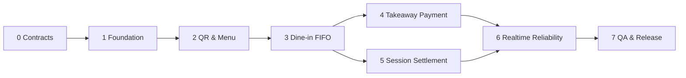

# PLAN — Lộ trình triển khai MVP & phối hợp Codex/Gemini

**Phương châm:** khách hàng trước, owner sau; chỉ 2 giao diện, 4 tab owner; backend chuẩn và an toàn ngay từ đầu. Các mốc dưới đây đo bằng **đầu ra có thể kiểm chứng**, không phụ thuộc số ngày tùy ý.

## 1. Phân vai cố định

| Agent | Trách nhiệm chính | Không phụ trách |
|---|---|---|
| **Codex** | Schema PostgreSQL/migrations, Next.js API, Auth, QR/session, validation, FIFO, thanh toán webhook, realtime, test, integration logic | Thiết kế lại UI, tự sửa design tokens/layout |
| **Gemini** | Visual design theo ảnh, design system, component shadcn/ui, responsive customer & owner, UX states, mock data, UI tests | Migration, SQL/FIFO, service/API logic, xác thực thanh toán |
| **Chủ dự án** | Chọn provider thanh toán, cung cấp tài khoản quán/demo, quyết định chính sách nhận món, đánh giá UX, nghiệm thu | Không cần tự thao tác nghiệp vụ trên hệ thống khi vận hành bình thường ngoài dashboard owner |

### Quy tắc làm song song
1. **Contract-first:** Codex công bố `types/contracts` và JSON response mẫu; Gemini dùng `mocks` đúng contract.
2. **Không xung đột file:** thay đổi mỗi agent chỉ trong vùng đã cấp ở `ARCHITECTURE.md`/`UI.md`.
3. **Không merge UI đẹp nhưng sai nghiệp vụ:** backend là nơi duy nhất xác nhận đã trả tiền, cấp ticket, nhận làm, hoàn tất.
4. **Mỗi chặng phải tích hợp và chạy thử**; không chờ đủ tất cả UI mới nối API.
5. Nếu thay contract: Codex viết ghi chú thay đổi, Gemini cập nhật mock và UI **sau khi thống nhất**, không tự suy diễn.

## 2. Tám chặng triển khai

### PHASE 0 — Khóa phạm vi & hợp đồng dữ liệu

| Codex | Gemini |
|---|---|
| Liệt kê entities, state machine, response JSON, lỗi chuẩn; tạo skeleton `types/contracts` | Tổng hợp image reference, tokens, wireframes hai giao diện, checklist states |

**Output:** quyết định `single owner`, `4 tabs`, `takeaway paid-before-queue`, sample fixtures và các loại order được duyệt.

**Gate:** hai agent dùng cùng names `OrderStatus`, `OrderType`, `PaymentStatus`, `ticketNo?`.

### PHASE 1 — Dựng nền tảng

| Codex | Gemini |
|---|---|
| Khởi tạo Next.js TS, Supabase dev, migrations, auth owner middleware, env schema, logging | Setup shadcn/ui, tokens, Inter/Be Vietnam Pro, responsive shell, component story/mock |

**Output:** app build chạy, owner login thử nghiệm, screenshot shell giống phong cách ảnh, DB seed.

**Gate:** `lint`, `typecheck`, DB migrate/seed chạy trên môi trường phát triển.

### PHASE 2 — QR, phiên bàn, menu

| Codex | Gemini |
|---|---|
| QR resolve, tạo/đóng phiên bàn, verify code, menu endpoint & CRUD, auth/token | Customer menu, search/category, item sheet, cart sheet; owner tab Bàn/Menu bằng mocks |

**Output:** quét QR bàn và QR quầy đều ra menu đúng chế độ; owner thêm món/đánh dấu hết hàng; mã phiên cũ từ chối.

**Gate:** guest không login; sản phẩm inactive không nhận đặt; quyền owner server-side.

### PHASE 3 — Dine-in order, hàng đợi và dashboard owner

| Codex | Gemini |
|---|---|
| Validate giỏ, snapshot giá, create order idempotent, ticket counter transaction, atomic claim, state transitions | Customer checkout dine-in, tracking; owner tab Đơn hàng list/detail, CTA FIFO, loading/empty/error |

**Output:** bàn quét QR → đặt → owner thấy ticket → nhận làm → sẵn sàng → đã phục vụ.

**Gate:** 100 concurrent create: không trùng ticket, retry cùng key không tạo order mới; cannot claim arbitrary ticket.

### PHASE 4 — Takeaway payment tự động

| Codex | Gemini |
|---|---|
| Adapter cho **một provider**, payment intent/QR, webhook verify & dedupe, paid→FIFO transaction, reconcile/errors | Checkout QR trả tiền, pending/confirm/fail/expired/error views, ticket tracking và mã nhận món |

**Output:** quét QR quầy → trả tiền tự động → nhận ticket đúng một lần → giao khi nhập mã hợp lệ.

**Gate:** provider sandbox test paid, duplicate webhook, forged webhook, wrong amount, late payment; unpaid không xuất hiện hàng đợi.

### PHASE 5 — Phiên bàn & hoàn thành vận hành

| Codex | Gemini |
|---|---|
| Tổng tiền phiên, settlement idempotent, khóa nhận order lúc checkout, đóng phiên, revoke guest token, audit | Owner Bàn: chi tiết phiên, total bill, xác nhận thu tiền, đóng bàn, trạng thái bàn |

**Output:** gọi thêm tạo ticket mới; khi checkout không race với gọi thêm; bàn cũ không cho đặt món.

**Gate:** không có double settlement; tính tiền snapshot đúng.

### PHASE 6 — Realtime, lỗi mạng, vận hành

| Codex | Gemini |
|---|---|
| Supabase private owner channel, guest secure channel hoặc polling fallback, outbox retries, rate limit, status reconciliation, observability | Reconnect banner, toasts, skeleton, optimistic-free safe interactions, độ tương phản, responsive polish |

**Output:** không mất trạng thái khi reload/disconnect; owner được cập nhật kịp, khách hiểu rõ pending tiền/đơn.

**Gate:** retry network không trùng đơn; unauthorized event channel bị từ chối, staging metrics có log.

### PHASE 7 — QA, deploy & pilot quán thật

| Codex | Gemini |
|---|---|
| E2E + security + load k6, migration prod, webhook production config, monitoring, backup/restore drill | UI QA nhiều màn hình, test 375/768/1280px, kiểm tra touch/contrast/microcopy |

**Output:** URL staging/prod hoạt động, runbook khôi phục, chủ quán thử nhận và giao đơn thật.

**Gate:** toàn bộ P0 pass, không còn lỗ hổng auth/payment nghiêm trọng, kiểm tra tải đạt ngưỡng quán tự đặt ra.

## 3. Sơ đồ phụ thuộc giữa các chặng



Gemini có thể dựng UI cho phases 2–5 bằng mock **từ phase 0**, không phải chờ Codex triển khai xong mỗi API. Tích hợp có thể chạy ngay khi module backend tương ứng ổn định.

## 4. Mốc bàn giao tối thiểu mỗi chặng

1. **Codex:** tài liệu endpoint và types cập nhật, migrations/seeds, test kết quả, thay đổi env, các lỗi còn tồn.
2. **Gemini:** mô tả screens/states, screenshots hoặc preview, components, responsive checklist, các data requirement mới.
3. **Integration:** danh sách file ownership không chồng, API mocks được đổi sang client thật, smoke test và regression pass.
4. **Chủ dự án:** nghiệm thu theo hành vi, không theo cảm giác UI đơn thuần.

### Merge/integration checklist dùng sau mỗi phase

```text
[ ] Không có hai agent chỉnh cùng file trừ khi đã thống nhất handoff
[ ] Không drift types/contracts giữa API và mock
[ ] Mọi form có loading, error, success
[ ] Không có nút click chỉ đổi UI state mà bỏ qua API production
[ ] Mọi hành động nhạy cảm được server xác thực
[ ] Không lộ payment secret/guest token trong client logs
[ ] pnpm/npm lint và TypeScript check pass
[ ] Migrations apply lên DB sạch; rollback có phương án
[ ] E2E chính của phase pass
```

## 5. Cách viết prompt cho hai agent (về sau)

Khi chuẩn bị làm **một phase**, tạo ba file nhiệm vụ riêng nếu có yêu cầu prompt:

```text
PHASE_XX/
├── CODEX_TASK.md        # Logic + API + DB + test
├── GEMINI_TASK.md       # UX/UI + shadcn + states + mocks
└── INTEGRATION.md       # Contract, file ownership, merge/test
```

### Prompt Codex phải có
- Bối cảnh sản phẩm và phần nghiệp vụ P0 đang giải quyết.
- Phạm vi files được phép sửa (server/API/schema/types).
- Input/output API, trạng thái đơn, transaction/idempotency/security cần giữ.
- Test cases chạy được, tiêu chí xong, không tự tạo màn hình mới.

### Prompt Gemini phải có
- Ảnh `assets/ui-reference.png`, token màu `UI.md`.
- Screens/components cần tạo và breakpoint.
- TypeScript data props từ contracts đã chốt; mock dữ liệu realistic.
- UI states success/error/pending/empty/loading, không code SQL/payment/FIFO.
- Không tự thêm screen `Kitchen`, `Bar`, `Staff` hoặc tab ngoài bốn tab owner.

### Prompt tích hợp phải có
- Branch/file ownership & contract version.
- Thứ tự nối API, cách xoá mock production.
- Test happy path + failure path + race conditions.

## 6. Chọn provider và nghiệm thu thanh toán

**Quyết định cần bổ sung trước phase 4:** chọn payOS **hoặc** SePay, cung cấp sandbox/API/webhook credentials theo tài liệu chính thức; xác minh kênh hỗ trợ QR động, HMAC verification, truy vấn trạng thái, chi phí và điều kiện pháp lý/dịch vụ. Không mặc định hai nhà cung cấp có hợp đồng API giống nhau.

**Với dine-in:** MVP cho owner xác nhận tiền mặt/chuyển khoản khi checkout bàn; không cần tự động hóa bước này trong đợt đầu. **Với takeaway:** chỉ giải phóng đơn vào chế biến sau xác nhận điện tử hợp lệ.

## 7. Kiểm soát hiệu suất và chi phí

- **Điểm nóng:** DB ticket counter là row lock mỗi quán/ngày; transaction phải ngắn, không gọi provider trong khóa.
- Menu cache/ETag, ảnh Next.js Image, queries có index, orders phân trang, subscription scoped.
- Load test theo số đơn được chấp nhận/giây thực tế; đo latency `POST orders`, webhook, claim queue, query dashboard.
- Có feature flag `accepting_orders=false` hoặc temporary pause khi vượt khả năng chế biến; UI thông báo rõ.
- Trước launch: xác minh Vercel function timeout, Supabase connection pool, giới hạn số kết nối, webhook retry và outbox processing trong gói dịch vụ thực dùng.

## 8. Điều kiện phát hành

- **P0 = 100%** theo `TASKS.md`; mọi P0 có test/đối chiếu hành vi.
- Không tồn tại lỗi nghiêm trọng về nhận sai tiền, tạo trùng ticket, mất quyền phiên bàn, lộ đơn người khác.
- Chủ quán thử hết chu trình bàn và mang đi trên điện thoại thật + máy quản lý thật.
- Quán đã có quy trình xử lý lỗi provider, mất mạng, hoàn tiền/hủy và kiểm tra tiền cuối ca.
