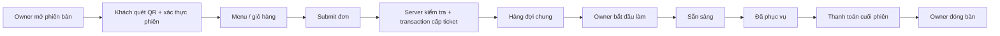

# PRD — Yêu cầu sản phẩm QR Ordering Minimal MVP

**Phiên bản:** 1.0 · **Trạng thái:** Baseline để triển khai · **Đối tượng:** quán ăn/cà phê/trà sữa có bàn và bán mang đi.

## 1. Vấn đề & mục tiêu

### Vấn đề
- Khi đông khách, gọi món bằng miệng dễ thiếu/nhầm/thất lạc đơn.
- Chủ quán khó xác định đơn nào nhận trước; khách bối rối vì phải hỏi liên tục.
- Khách mang đi thanh toán thủ công dễ tạo nút thắt ở quầy.

### Mục tiêu sản phẩm
- Khách tự đặt món không cần đăng nhập.
- Chủ quán theo dõi và thao tác đơn từ **một bảng điều khiển**.
- Hàng đợi có số thứ tự minh bạch; **chỉ cấp khi đơn đủ điều kiện chế biến**.
- Giảm thao tác xác minh tiền mang đi bằng webhook tự động.
- Thiết kế gọn, nhanh, chịu tải đột biến **sau khi được kiểm thử** (không cam kết số lượt đồng thời chỉ dựa trên kiến trúc).

### KPIs đề xuất, cần đo thực tế
- Tỉ lệ đặt món thành công, tỉ lệ thanh toán takeaway thành công.
- Tỉ lệ tạo đơn/ticket trùng = **0** theo idempotency key/tài nguyên thanh toán.
- Thời gian từ xác nhận hợp lệ đến hiển thị ở dashboard; độ trễ cập nhật trạng thái.
- Thời gian chờ trung vị/95th của hàng đợi; số đơn quá hạn.
- Lỗi thanh toán chưa đối soát = 0 sau quy trình đối soát cuối ngày.

## 2. Vai trò — chỉ 2

| Vai trò | Đăng nhập | Được phép | Không được phép |
|---|---|---|---|
| **Khách (Guest)** | Không | Xem menu, đặt món qua QR hợp lệ, xem đơn thuộc phạm vi truy cập, thanh toán takeaway, theo dõi và nhận món | Đổi giá, xác nhận tiền, thay số FIFO, chuyển trạng thái chế biến |
| **Chủ quán (Owner)** | Có, Supabase Auth | Menu, bàn, đơn, bắt đầu/hoàn tất/giao món, theo dõi thanh toán, QR, cài đặt | Bỏ qua xác thực webhook hoặc xóa dấu vết thanh toán |

Owner kiêm bếp, pha chế, phục vụ, thu ngân, admin. **Không triển khai RBAC nhân viên** ở MVP. Tài khoản chủ quán cần thuộc đúng `store_id` (kiểm tra server-side).

## 3. Hai loại QR

### `table` — QR dán tại bàn
- QR cố định chứa mã bàn **không phải** bí mật để đăng nhập.
- Chủ quán mở `table_session` khi khách đến và cung cấp mã phiên ngắn/QR phiên động.
- Khách xác thực phiên trước khi đặt món. Có thể nhiều thiết bị cùng phiên và đặt độc lập.
- Đơn mới/gọi thêm tạo ticket mới. Hóa đơn tổng hợp theo phiên bàn.
- Phiên cũ hết hiệu lực sau khi đóng; không cho đặt món từ ảnh QR cũ kèm mã phiên cũ.

### `takeaway` — QR đặt tại quầy
- QR công khai dẫn đến menu ở chế độ mang đi.
- Không có phiên bàn; tạo `pending_payment` khi checkout.
- Khách thanh toán đúng yêu cầu, backend xác thực webhook; **lúc đó mới cấp ticket** và đưa vào hàng đợi.
- Theo dõi đơn bằng liên kết/token riêng; giao hàng theo ticket **kèm mã nhận món**.

## 4. Quy trình nghiệp vụ

### 4.1 Dine-in

**Điều kiện:** bàn có một phiên đang mở, sản phẩm còn bán, giá do server tính; gọi thêm là đơn mới. Khi bàn vào bước thu tiền, khóa nhận đơn hoặc hủy bước thu tiền trước khi nhận món mới.

### 4.2 Takeaway

```mermaid
flowchart LR
 A[Khách quét QR quầy] --> B[Menu / giỏ]
 B --> C[Tạo đơn chờ thanh toán]
 C --> D[Hiển thị QR thanh toán]
 D --> E[Gateway xác nhận giao dịch]
 E --> F[Webhook server xác thực]
 F --> G[Transaction: paid + ticket]
 G --> H[Hàng đợi chung]
 H --> I[Owner chế biến]
 I --> J[Sẵn sàng]
 J --> K[Xác minh mã nhận + giao]
```

**Lưu ý FIFO:** tính theo thứ tự giao dịch **chấp nhận đơn thành công tại server/DB**, không theo lúc quét QR hoặc bắt đầu trả tiền. Nếu hai webhook đến cùng lúc, một transaction khóa bộ đếm sẽ cấp ticket duy nhất. Thanh toán chậm không được chèn lại vào đầu hàng.

### 4.3 Chủ quán xử lý đơn (dùng chung)
1. Mở dashboard mặc định tab **Đơn hàng**.
2. Nhìn danh sách sắp xếp ticket tăng dần, phân biệt **Bàn XX** / **Mang đi**.
3. Bấm **Nhận đơn tiếp theo**; backend chọn đơn `accepted` đầu hàng bằng transaction/lock.
4. Bấm **Sẵn sàng** khi làm đủ các món của đơn.
5. **Dine-in:** mang ra bàn, bấm **Đã phục vụ**. **Takeaway:** kiểm tra mã nhận món, bấm **Đã giao**.
6. Quản lý lỗi qua thao tác ngoại lệ có xác nhận và ghi audit (không sửa ticket tùy ý).

**MVP cố tình xử lý theo cấp đơn**, không chia task bếp/bar riêng. Một đơn nhiều món cùng một trạng thái chế biến; nếu cần chuẩn bị đồng thời ở nhiều khu vực sẽ nâng cấp ở giai đoạn sau. Owner có thể nhận nhiều đơn đang làm; nút “nhận tiếp” phải chọn FIFO, không chọn ngẫu nhiên.

## 5. Tính năng sản phẩm (theo mã FR)

### Khách hàng

| ID | Mức | Yêu cầu | Chấp nhận khi |
|---|---|---|---|
| FR-C01 | P0 | Quét hai loại QR, nhận biết chế độ | Có nhãn bàn/quầy đúng; QR vô hiệu hiển thị lỗi rõ |
| FR-C02 | P0 | Xác thực phiên bàn | Không thể đặt bằng phiên sai/hết hạn |
| FR-C03 | P0 | Danh sách menu, nhóm, giá, còn/hết | Chỉ hiển thị sản phẩm đang bán, giá được cập nhật |
| FR-C04 | P0 | Giỏ hàng & ghi chú/tùy chọn đơn giản | Giá, số lượng được kiểm tra lại ở server |
| FR-C05 | P0 | Submit dine-in | Nhận một đơn & một ticket dù bấm lại/retry cùng key |
| FR-C06 | P0 | Submit takeaway | Có đơn chờ tiền và QR giao dịch duy nhất, **chưa có ticket** |
| FR-C07 | P0 | Theo dõi trạng thái realtime | Đúng đơn/phiên, refresh không mất trạng thái |
| FR-C08 | P0 | Hiện ticket và mã nhận takeaway | Không lộ mã nhận cho người ngoài |
| FR-C09 | P0 | Nhận biết lỗi/mạng yếu/thanh toán chậm | Có pending/error/retry rõ; không thúc khách trả tiền lại ngay |
| FR-C10 | P1 | Gọi thêm tại bàn, xem tổng tiền | Tạo ticket mới, hóa đơn cùng phiên bàn |

### Chủ quán

| ID | Mức | Yêu cầu | Chấp nhận khi |
|---|---|---|---|
| FR-O01 | P0 | Login, logout, bảo vệ dashboard | Guest không truy cập được API owner |
| FR-O02 | P0 | Dashboard đơn hàng realtime | Mới/chờ/đang làm/sẵn sàng hiển thị rõ |
| FR-O03 | P0 | Nhận đơn tiếp theo FIFO | Không claim trùng; không bỏ qua đơn trước không có lý do |
| FR-O04 | P0 | Chuyển `preparing → ready → completed` | Backend kiểm tra chuyển trạng thái hợp lệ |
| FR-O05 | P0 | Quản lý bàn & phiên bàn | Một bàn tối đa một phiên mở, khóa QR phiên cũ |
| FR-O06 | P0 | Menu CRUD đơn giản & đánh dấu hết hàng | Đơn cũ giữ tên/giá snapshot |
| FR-O07 | P0 | Xem trạng thái tiền takeaway | Chỉ chuyển paid từ nguồn xác thực |
| FR-O08 | P0 | Thanh toán cuối phiên bàn | Kiểm tra đơn còn mở; không thanh toán trùng |
| FR-O09 | P0 | Giao takeaway có xác minh | Chỉ đánh dấu đã giao khi mã hợp lệ |
| FR-O10 | P1 | Tạm ngừng nhận đơn / ẩn món | Khách được thông báo tức thời |
| FR-O11 | P1 | Hủy đơn/hoàn tiền ngoại lệ | Có lý do, audit, trạng thái chính xác |
| FR-O12 | P1 | QR & cài đặt quán | Tạo/khóa QR, đổi mã phiên; không lộ secrets |

### Hệ thống

| ID | Mức | Yêu cầu | Chấp nhận khi |
|---|---|---|---|
| FR-S01 | P0 | Counter ticket transaction | Ticket unique `(store_id, service_date, ticket_no)` |
| FR-S02 | P0 | Idempotency order/payment | Retry/webhook trùng không tạo hai đơn chế biến |
| FR-S03 | P0 | Webhook bảo mật | Kiểm chữ ký, amount, currency, reference, event ID |
| FR-S04 | P0 | Realtime có reconnect/re-sync | Refresh/reconnect khớp database |
| FR-S05 | P0 | RLS + kiểm quyền API | Tenant isolation, không có service role ở client |
| FR-S06 | P0 | Transaction và giới hạn lượt | Không nhận đơn nửa chừng; hạn chế spam QR/API |
| FR-S07 | P1 | Audit + đối soát ngoại lệ | Có log để xử lý tiền về muộn/sai số |
| FR-S08 | P1 | Kiểm thử tải | Kịch bản nhiều khách, reconnect, retry được kiểm chứng |

## 6. Trạng thái & chuyển trạng thái

### Đơn hàng — `orders.status`

| Trạng thái | Ý nghĩa | Cách vào |
|---|---|---|
| `pending_payment` | Takeaway chờ thanh toán | Guest checkout tạo intent |
| `accepted` | Đã vào hàng, đang chờ làm | Dine-in confirmed; takeaway webhook paid |
| `preparing` | Chủ quán đang làm | Claim next atomically |
| `ready` | Sẵn sàng giao | Owner xác nhận chế biến đủ |
| `completed` | Đã giao/đã phục vụ | Owner xác nhận, takeaway phải verify pickup |
| `cancelled` | Đơn đã hủy hợp lệ | Chính sách hủy, audit & refund khi cần |
| `payment_exception` | Cần xử lý thanh toán bất thường | Ví dụ tiền về sau expiry, mismatch |

`ticket_no` nullable trong `pending_payment` và `payment_exception` chưa được chấp nhận; sau khi `accepted` phải **bất biến**. `cancelled` có thể giữ ticket đã cấp để audit, không tái sử dụng.

### Thanh toán — `payment_intents.status`
`pending → succeeded | failed | expired`; trường hợp thanh toán muộn/không khớp cần đánh dấu reconciliation và giữ chứng từ. Dine-in có `session_settlements` độc lập, không dùng `takeaway payment_intent` để tính hóa đơn bàn.

### Phiên bàn — `table_sessions.status`
`open → checkout_pending → closed`; chuyển về `open` chỉ bằng thao tác chủ quán có điều kiện khi chưa ghi settlement. Sau `closed` chỉ mở phiên **mới**.

## 7. Luật và edge cases quan trọng

1. **Không phát số FIFO khi takeaway mới tạo QR thanh toán.**
2. Webhook chỉ chấp nhận từ backend đã **xác thực theo tài liệu provider**, không từ ảnh/redirect/client callback.
3. Chữ ký đúng nhưng amount/reference không đúng: không ghi `paid`, đưa vào đối soát.
4. Webhook duplicate/out-of-order: xử lý idempotent, trạng thái cuối không lùi.
5. Tiền nhận sau khi intent hết hạn: giữ evidence, báo owner xử lý, **không âm thầm đẩy vào bếp**.
6. Phiên bàn đóng trong lúc guest checkout: từ chối submit; client hiển thị cần hỗ trợ.
7. Owner đã bắt đầu chế biến: hủy/trả tiền theo quy trình ngoại lệ, không xóa đơn.
8. Hết hàng giữa lúc khách chọn và submit: báo lỗi cụ thể, yêu cầu xác nhận lại giỏ.
9. Payment provider lỗi: màn hình pending với trạng thái polling/refetch, không yêu cầu chuyển khoản lần hai trừ khi chắc chắn giao dịch trước thất bại/hết hạn.
10. Realtime mất: vẫn lưu được dữ liệu; tải lại snapshot theo API, tránh giả định event là nguồn sự thật.
11. Chủ quán bấm hai lần “Nhận tiếp”: không claim hai lần cùng một thao tác; điều kiện DB chặn claim trùng.
12. Checkout bàn trong lúc gọi thêm: lock phiên/kiểm tra tổng tiền trong transaction.
13. Khách xem order theo opaque access token hoặc phiên bàn hợp lệ; ticket số thứ tự không phải mã truy cập.
14. Takeaway nhận món: cần chứng thực mã riêng; mã không được đưa vào feed công khai.

## 8. Yêu cầu phi chức năng

- **Hiệu năng:** mobile-first; tải ảnh tối ưu, menu cache hợp lý, phân trang/lọc đơn; đo Web Vitals và p95 API trên staging.
- **Tải:** k6 mô phỏng >=100 lượt submit gần đồng thời, duplicate retry, một owner claim; số lớn hơn tùy ngân sách hạ tầng và kết quả thử tải; ghi p50/p95, lỗi, timeout.
- **Khả dụng:** hoạt động đúng khi webhook/realtime đến trễ hoặc gửi lại; trạng thái giao dịch không mất nếu refresh.
- **Bảo mật:** HTTPS, xác thực owner, token guest, ký webhook, rate limit, khóa xử lý server, secret storage, audit.
- **Độ chính xác:** tiền VND số nguyên; server snapshot giá; thời gian lưu `timestamptz` UTC, ngày kinh doanh tính theo timezone quán.
- **Dễ sử dụng:** nhãn và trạng thái bằng tiếng Việt, màu luôn đi kèm chữ/icon, tap target tối thiểu ~44px, tương phản văn bản phù hợp.

## 9. Ngoài phạm vi & tiêu chí phát hành

**Out-of-scope:** kho hàng chi tiết, split bill, đa điểm bán, loyalty, nhiều account nhân viên, phân luồng bếp/bar riêng, native app, sàn giao đồ ăn, tự động in hóa đơn, quản lý sơ đồ tầng.

**Release gate:** hoàn tất toàn bộ P0 trong `TASKS.md`, test thanh toán thực sandbox/provider, test tải & bảo mật theo `PLAN.md`, chạy thử nội bộ tại quán rồi mới mở cho khách.
