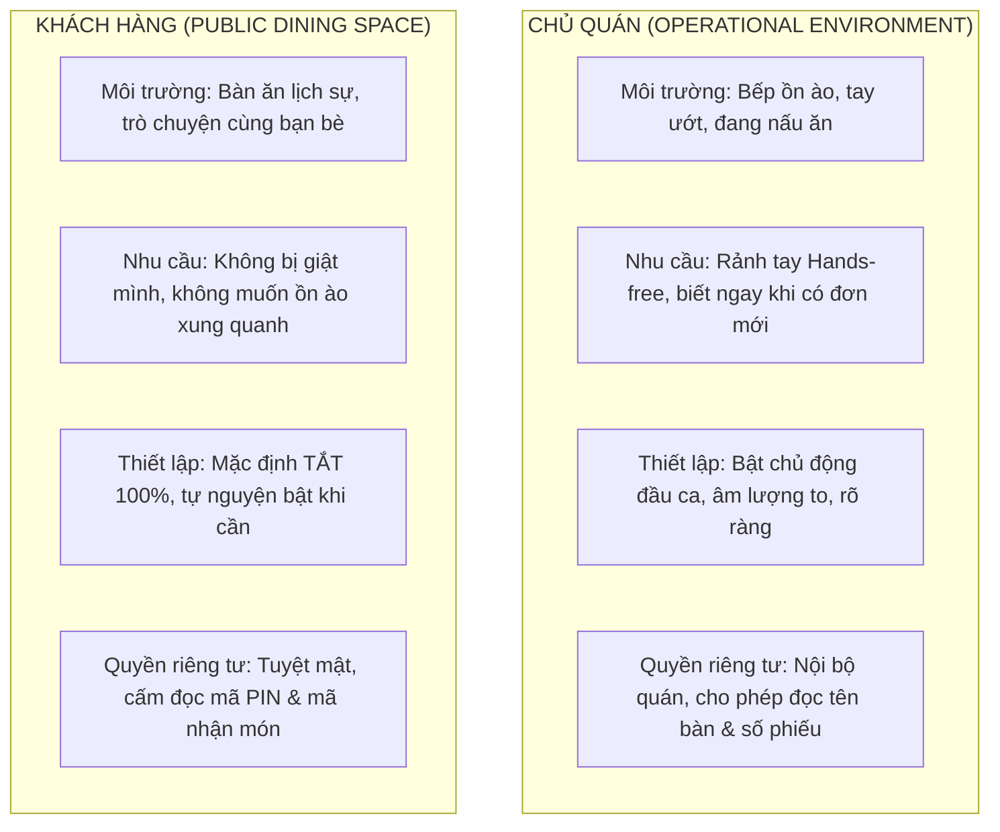

# VOICE_A01 — AUDIT UX THÔNG BÁO GIỌNG NÓI (MINIMAL EMERALD)
**Báo cáo khảo sát trải nghiệm thông báo âm thanh & giọng nói cho Khách hàng & Chủ quán**  
**Agent:** Gemini (UI/UX, Accessibility, Behavior Design & Next.js Presentation)  
**Tài liệu kỹ thuật đối ứng:** `VOICE_A01_CODEX_AUDIT_VOICE_EVENTS_TECHNICAL.md`  
**Trạng thái:** CHỈ AUDIT & THIẾT KẾ — KHÔNG THAY ĐỔI CODE RUNTIME / PACKAGES / BACKEND.  
**Ngày thực hiện:** 24/10/2026  

---

## 1. Tổng quan & Giới hạn bắt buộc

### 1.1. Bối cảnh dự án
Hệ thống **QR Ordering Minimal MVP (Phở Việt POS)** vận hành theo triết lý tinh gọn:
- **Khách hàng (Mobile-first, không tài khoản)**:
  - *Tại bàn (Dine-in)*: Quét QR cố định tại bàn + xác thực PIN 6 số của phiên bàn, gọi món, theo dõi tiến độ, xem hóa đơn tạm tính và hóa đơn đã thanh toán kèm lời cảm ơn.
  - *Mang đi (Takeaway)*: Quét QR mang đi chung, chọn món, thanh toán tự động qua VietQR, nhận số thứ tự nhận món (ticketNo) và mã nhận món 6 chữ số khi món sẵn sàng tại quầy.
- **Chủ quán (Owner Dashboard - 4 tab)**:
  - Tab *Đơn hàng*: Hàng đợi FIFO trực quan (70/30 desktop, 1 cột mobile), nút nhận đơn FIFO trung tâm (*"Nhận đơn tiếp theo"*), chuyển trạng thái *Đang làm* → *Sẵn sàng* → *Hoàn tất*, xác minh mã nhận món mang đi.
  - Tab *Bàn*: Lưới trạng thái bàn, quản lý PIN 6 số, mở phiên, chốt tiền và đóng phiên bàn.
  - Tab *Menu*: Quản lý danh mục, món ăn, bật/tắt hết hàng.
  - Tab *Cài đặt*: Điều khiển nhận đơn toàn quán (Admission Control: Master / Dine-in / Takeaway), cấu hình VietQR.
- **Triết lý thiết kế Minimal Emerald**:
  - Tông màu chủ đạo: Emerald `#35977D` / `#1D725E`, nền xám nhạt `#F5F6F5` / `#FAFBFB`, viền trung tính `#E9ECEA`, bo góc mềm 16px–28px, pill navigation, nhiều khoảng trắng, tương phản cao và rõ ràng.

### 1.2. Giới hạn bắt buộc của pha Audit
1. **Tuyệt đối KHÔNG code**: Không cài thư viện mới (Sonner npm, Web Speech API wrapper, audio elements, state store, hooks, backend endpoint hay migration).
2. **Không nhân đôi hệ thống UI Notification**: Dự án đã có hệ thống Toast nổi dạng Sonner-style và Banner trạng thái. Voice Notification chỉ đóng vai trò kênh phụ trợ (complementary assistive channel), hoàn toàn không thay thế hoặc phá vỡ hệ thống hiển thị trực quan sẵn có.
3. **Bảo mật tuyệt đối thông tin nhạy cảm**: Nghiêm cấm đọc thành tiếng:
   - Mã PIN bàn 6 số.
   - Mã nhận món Takeaway 6 số.
   - Access token / Session token.
   - Số tài khoản ngân hàng / Chi tiết tài khoản VietQR.
   - Số điện thoại cá nhân và chi tiết danh sách món kèm tiền của khách khác.
4. **Nguyên tắc "Silent by Default" cho Khách hàng**: Tránh gây ồn ào không gian quán và không làm giật mình khách hàng.

---

## 2. Khảo sát thực tế 2 bề mặt UI (Codebase File:Line Audit)

### 2.1. Bề mặt 1: Owner Dashboard

| Thành phần / Luồng | File thực tế | Dòng code | Trạng thái hiển thị hiện tại | Đánh giá UX Âm thanh / Giọng nói |
| :--- | :--- | :--- | :--- | :--- |
| **Khung Dashboard & Tab Navigation** | [OwnerShell.tsx](file:///e:/Project/QR-Ordering-PV/src/components/owner/OwnerShell.tsx) | L54-L79 | Header chứa 4 tab (Đơn hàng, Bàn, Menu, Cài đặt), container chia cột responsive | Chưa có bất kỳ nút bật âm thanh (Volume toggle) hoặc icon loa nào |
| **Thanh Header Đơn hàng & Bộ đếm** | [QueueHeader.tsx](file:///e:/Project/QR-Ordering-PV/src/components/owner/orders/QueueHeader.tsx) | L42-L105 | Huy hiệu số lượng: *Chờ* (`counts.accepted`), *Đang làm* (`counts.preparing`), *Sẵn sàng* (`counts.ready`), *Cần đối soát* (`counts.paymentException`), Nút *"Làm mới"* (`RefreshCw`) | Vị trí lý tưởng nhất trên Desktop/Tablet để đặt nút Volume toggle (bên cạnh nút *"Làm mới"*) |
| **Hàng đợi đơn & Nút FIFO trung tâm** | [OwnerOrdersView.tsx](file:///e:/Project/QR-Ordering-PV/src/components/owner/orders/OwnerOrdersView.tsx) [ClaimNextButton.tsx](file:///e:/Project/QR-Ordering-PV/src/components/owner/orders/ClaimNextButton.tsx) | L757-L765 L1-L60 | Nút lớn *"Nhận đơn tiếp theo"* theo FIFO; danh sách card đơn scrollable | Không có nút claim trên từng card; âm thanh không được phát khi bấm thủ công nút này |
| **Thông báo đơn mới đến (Polling)** | [OwnerOrdersView.tsx](file:///e:/Project/QR-Ordering-PV/src/components/owner/orders/OwnerOrdersView.tsx) | L222-L235 | `showToast('info', 'Có X đơn mới...')` khi phát hiện đơn `accepted` mới qua polling 6s | Đã có logic gộp đơn (`freshAccepted.length > 1`). Đây là điểm neo (hook anchor) hoàn hảo để kích hoạt giọng đọc |
| **Hệ thống Toast nổi Sonner-style** | [OwnerOrdersView.tsx](file:///e:/Project/QR-Ordering-PV/src/components/owner/orders/OwnerOrdersView.tsx) | L704-L736 | Banner Toast nổi `role="status" aria-live="polite"` góc trên danh sách đơn | UI Toast đã hoạt động mượt mà; giọng đọc sẽ chạy song song với Toast này, không tạo thêm modal |
| **Chi tiết phiếu đơn & Hành động** | [OrderDetailPanel.tsx](file:///e:/Project/QR-Ordering-PV/src/components/owner/orders/OrderDetailPanel.tsx) | L238-L350 | Nút *"Sẵn sàng phục vụ"* (`markReady`), *"Hoàn tất phục vụ"* (`complete`), *"Xác minh nhận món & Giao đơn"* | Hành động do chính chủ quán bấm -> **VISUAL ONLY**, tuyệt đối không đọc tiếng gây phiền |
| **Xác minh mã nhận món mang đi** | [TakeawayPickupVerificationDialog.tsx](file:///e:/Project/QR-Ordering-PV/src/components/owner/orders/TakeawayPickupVerificationDialog.tsx) | L1-L220 | Dialog nhập mã 6 số từ khách; Toast thành công *"Đơn #... đã hoàn tất giao món"* | Visual feedback rõ ràng; không đọc mã nhận món |
| **Tab Bàn & Chốt tiền / Đóng phiên** | [TableManagementView.tsx](file:///e:/Project/QR-Ordering-PV/src/components/owner/tables/TableManagementView.tsx) [TableBillSettlementSheet.tsx](file:///e:/Project/QR-Ordering-PV/src/components/owner/tables/TableBillSettlementSheet.tsx) | L1001-L1025 L419-L550 | Toast Sonner nổi, Sheet hóa đơn chốt tiền bàn, dialog xác nhận thu tiền, đóng phiên | Nếu có tính năng khách gọi thanh toán -> đọc thông báo; khi chủ quán tự chốt tiền -> không đọc |
| **Tab Cài đặt quán** | [OwnerSettingsView.tsx](file:///e:/Project/QR-Ordering-PV/src/components/owner/settings/OwnerSettingsView.tsx) [StoreAdmissionControlCard.tsx](file:///e:/Project/QR-Ordering-PV/src/components/owner/settings/StoreAdmissionControlCard.tsx) | L1-L120 L1-L200 | Điều khiển tạm dừng nhận đơn (Admission), cấu hình VietQR | Phù hợp đặt phần cấu hình nâng cao cho giọng đọc (chọn sự kiện đọc, kiểm tra giọng đọc demo) |

---

### 2.2. Bề mặt 2: Customer UI (Dine-in & Takeaway)

| Thành phần / Luồng | File thực tế | Dòng code | Trạng thái hiển thị hiện tại | Đánh giá UX Âm thanh / Giọng nói |
| :--- | :--- | :--- | :--- | :--- |
| **Xác thực mã PIN bàn (Dine-in)** | [TableVerificationCard.tsx](file:///e:/Project/QR-Ordering-PV/src/components/customer/TableVerificationCard.tsx) | L25-L85 | 6 ô nhập PIN (XXX XXX), lỗi PIN sai, trạng thái loading | **NEVER SPEAK**: Tuyệt đối không đọc PIN bàn hay báo lỗi PIN bằng giọng nói (bảo mật bàn bên) |
| **Thực đơn & Giỏ hàng khách** | [CustomerQRContainer.tsx](file:///e:/Project/QR-Ordering-PV/src/components/customer/CustomerQRContainer.tsx) [CartSheet.tsx](file:///e:/Project/QR-Ordering-PV/src/components/customer/cart/CartSheet.tsx) | L75-L167 L1-L150 | Lưới món ăn, sheet tùy chọn, giỏ hàng nổi, modal đặt món | **NEVER SPEAK**: Thao tác chọn món/giỏ hàng là tương tác vi mô của khách, chỉ dùng visual feedback |
| **Theo dõi tiến độ đơn hàng** | [OrderTrackingView.tsx](file:///e:/Project/QR-Ordering-PV/src/components/customer/order/OrderTrackingView.tsx) | L58-L88 L238-L308 | Stepper 4 bước (*Đã nhận đơn* → *Đang làm* → *Sẵn sàng* → *Đã phục vụ*), polling 6s | Điểm đặt nút Volume toggle dành cho khách; chỉ đọc khi trạng thái chuyển sang *Sẵn sàng* hoặc *Hoàn tất* |
| **Thẻ nhận món mang đi (Takeaway)** | [TakeawayPickupCard.tsx](file:///e:/Project/QR-Ordering-PV/src/components/customer/order/TakeawayPickupCard.tsx) | L130-L160 L160-L195 | Banner nổi bật *"Món của bạn đã sẵn sàng! Vui lòng đến quầy nhận món"*, mã 6 số (format "XXX XXX") | **SPEAK WHEN ENABLED**: Đọc thông báo đơn đã sẵn sàng ra quầy. **CẤM đọc 6 số mã nhận món** |
| **Thanh toán VietQR Takeaway** | [PaymentStatusPanel.tsx](file:///e:/Project/QR-Ordering-PV/src/components/customer/payment/PaymentStatusPanel.tsx) [TakeawayPaymentView.tsx](file:///e:/Project/QR-Ordering-PV/src/components/customer/payment/TakeawayPaymentView.tsx) | L42-L132 L1-L200 | 7 trạng thái: `pending_payment`, `verifying`, `paid` (hiển thị số ticket FIFO), `expired`, `failed`, `review_required` | Tuyệt đối không đọc khi đang `verifying`. CHỈ đọc khi backend xác nhận `paid` chính thức |
| **Hóa đơn & Lời cảm ơn (Dine-in)** | [TableBillSheet.tsx](file:///e:/Project/QR-Ordering-PV/src/components/customer/bill/TableBillSheet.tsx) | L122-L135 L160-L186 L230-L260 | Floating Toast nổi 1 lần khi `isPaid`, Banner *"Thanh toán thành công"*, Lời cảm ơn của quán | **SPEAK WHEN ENABLED**: Đọc ngắn gọn *"Đã thanh toán thành công. Cảm ơn quý khách!"* khi chủ quán đóng phiên |
| **Xử lý đơn phiên cũ (Session Isolation)** | [CustomerQRContainer.tsx](file:///e:/Project/QR-Ordering-PV/src/components/customer/CustomerQRContainer.tsx) | L125-L148 | `isOrderFromPastSession`, tự động gọi `clearActiveOrderSummary(qrCode)` | Ngăn chặn hoàn toàn việc phát giọng nói về đơn của khách trước khi khách mới quét QR |

---

## 3. Ma trận sự kiện & giọng đọc đối chiếu Backend Codex

Bảng phân tích toàn diện 10 tiêu chí theo yêu cầu nghiệm thu:

| # | Event | Nơi hiển thị UI hiện tại (file:line) | Target audience | UX priority | Voice policy | Trigger lấy từ Codex | Nội dung giọng đề xuất (Tiếng Việt) | Dedupe / Cooldown | Fallback khi không hỗ trợ âm thanh |
| :-: | :--- | :--- | :--- | :-: | :---: | :--- | :--- | :--- | :--- |
| **E01** | Đơn Dine-in mới vào hàng đợi | [OwnerOrdersView.tsx:223](file:///e:/Project/QR-Ordering-PV/src/components/owner/orders/OwnerOrdersView.tsx#L223) | Chủ quán | High | **SPEAK DEFAULT WHEN ENABLED** | R07 `data.orders` xuất hiện đơn `accepted` mới chưa có trong `knownOrderIdsRef` | *"Có đơn mới tại {tableLabel}, số phiếu {ticketNumber}."* | Cooldown 2s; gom nhóm nếu >= 2 đơn: *"Có {count} đơn mới trong hàng đợi."* | Floating Toast Sonner màu xanh dương + Badge số đếm `QueueHeader` nhảy số |
| **E02** | Đơn Takeaway mới đã thanh toán vào hàng đợi | [OwnerOrdersView.tsx:223](file:///e:/Project/QR-Ordering-PV/src/components/owner/orders/OwnerOrdersView.tsx#L223) | Chủ quán | High | **SPEAK DEFAULT WHEN ENABLED** | R07 `data.orders` xuất hiện đơn `type === 'takeaway'` với status `accepted` | *"Có đơn mang đi mới, số phiếu {ticketNumber}."* | Cooldown 2s; gom nhóm nếu >= 2 đơn: *"Có {count} đơn mang đi mới."* | Floating Toast Sonner + Tăng số lượng `counts.accepted` |
| **E03** | Khách tại bàn yêu cầu thanh toán | [TableManagementView.tsx:1001](file:///e:/Project/QR-Ordering-PV/src/components/owner/tables/TableManagementView.tsx#L1001) | Chủ quán | Medium | **OPTIONAL (Cấu hình trong Cài đặt)** | R11 `table.session.status === 'checkout_pending'` | *"{tableLabel} yêu cầu thanh toán."* | Dedupe theo `session.id:checkout_pending`, chỉ đọc 1 lần duy nhất | Badge màu cam trên bàn (*"Đang thanh toán"*) + Toast Sonner |
| **E04** | Đơn phát sinh ngoại lệ đối soát thanh toán | [OwnerOrdersView.tsx:75](file:///e:/Project/QR-Ordering-PV/src/components/owner/orders/OwnerOrdersView.tsx#L75) | Chủ quán | High | **OPTIONAL (Hạn chế tần suất)** | R07 `counts.paymentException > 0` hoặc order có `isHeldForReview` | *"Có giao dịch cần đối soát thanh toán."* | Cooldown tối thiểu 60s/lần nhắc; không lặp liên tục | Huy hiệu màu đỏ `counts.paymentException` tại header + Banner cảnh báo vàng |
| **E05** | Chủ quán tự thao tác (Claim, Ready, Complete) | [OwnerOrdersView.tsx:516,549,619](file:///e:/Project/QR-Ordering-PV/src/components/owner/orders/OwnerOrdersView.tsx#L516) | Chủ quán | Low | **NEVER SPEAK** | R08 claimNext, R09 markOrderReady, R10 completeOrder thành công | *(Không phát âm thanh)* | N/A | Toast phản hồi thao tác thành công + cập nhật trạng thái UI tức thì |
| **E06** | Khách Dine-in đặt món thành công | [OrderConfirmedView.tsx:50](file:///e:/Project/QR-Ordering-PV/src/components/customer/order/OrderConfirmedView.tsx#L50) | Khách Dine-in | Medium | **OPTIONAL (Mặc định TẮT)** | R04 POST /api/public/orders thành công, nhận `order.id` và `ticketNo` | *"Quán đã nhận đơn số {ticketNumber}."* | Chỉ đọc 1 lần ngay sau khi đặt hàng thành công | Màn hình OrderConfirmedView với biểu tượng tick xanh và số phiếu lớn |
| **E07** | Món Dine-in đã làm xong (Ready) | [OrderTrackingView.tsx:77](file:///e:/Project/QR-Ordering-PV/src/components/customer/order/OrderTrackingView.tsx#L77) | Khách Dine-in | Low | **VISUAL ONLY (Mặc định quán tự bưng món)** | R05 `order.status === 'ready'` | *(Tùy chọn: "Món của bạn đã sẵn sàng.")* | Chỉ đọc 1 lần khi chuyển bước | Stepper chuyển bước số 3 màu xanh lục (*"Sẵn sàng"*) |
| **E08** | Khách Dine-in được đóng phiên / đã thanh toán | [TableBillSheet.tsx:122](file:///e:/Project/QR-Ordering-PV/src/components/customer/bill/TableBillSheet.tsx#L122) | Khách Dine-in | High | **SPEAK WHEN ENABLED (Nếu khách đã bật)** | R12 `bill.session.paymentStatus === 'paid'` hoặc `settledAt !== null` | *"Đã thanh toán thành công. Cảm ơn quý khách!"* | Dedupe theo `session.id:settledAt`, chỉ đọc duy nhất 1 lần | Toast Sonner xanh lục + Thẻ cảm ơn + Hóa đơn chi tiết |
| **E09** | Khách Takeaway thanh toán thành công qua VietQR | [PaymentStatusPanel.tsx:96](file:///e:/Project/QR-Ordering-PV/src/components/customer/payment/PaymentStatusPanel.tsx#L96) | Khách Takeaway | High | **SPEAK WHEN ENABLED (Nếu khách đã bật)** | R06 Webhook / Polling xác nhận `status === 'paid'` kèm `ticketNo` | *"Đơn số {ticketNumber} đã thanh toán thành công."* | Dedupe theo `order.id:paid`, tuyệt đối không đọc khi đang verifying | Panel xanh lá, icon CheckCircle2, hiển thị số thứ tự nhận món lớn |
| **E10** | Món Takeaway đã sẵn sàng ra quầy | [TakeawayPickupCard.tsx:130](file:///e:/Project/QR-Ordering-PV/src/components/customer/order/TakeawayPickupCard.tsx#L130) | Khách Takeaway | Critical | **SPEAK WHEN ENABLED (Khuyến khích bật)** | R05 `order.status === 'ready'` và `type === 'takeaway'` | *"Đơn số {ticketNumber} đã sẵn sàng. Vui lòng đến quầy nhận món."* | Dedupe theo `order.id:ready`, chỉ đọc 1 lần | Thẻ xanh dương nổi bật, chuông lắc BellRing, mã nhận món 6 số trên màn hình |
| **E11** | Khách Takeaway đã nhận món tại quầy | [TakeawayPickupCard.tsx:82](file:///e:/Project/QR-Ordering-PV/src/components/customer/order/TakeawayPickupCard.tsx#L82) | Khách Takeaway | Medium | **OPTIONAL (Nếu khách đã bật)** | R05 `order.status === 'completed'` | *"Cảm ơn quý khách. Hẹn gặp lại!"* | Chỉ đọc 1 lần khi hoàn tất | Thẻ chuyển sang trạng thái "Đã nhận món tại quầy", mask mã "••••••" |
| **E12** | Nhập PIN sai, Mất mạng, Reconnect, Quá tải 429 | [TableVerificationCard.tsx:72](file:///e:/Project/QR-Ordering-PV/src/components/customer/TableVerificationCard.tsx#L72) [OwnerOrdersView.tsx:266](file:///e:/Project/QR-Ordering-PV/src/components/owner/orders/OwnerOrdersView.tsx#L266) | Mọi người | Critical Security | **NEVER SPEAK** | Lỗi 401, 403, 404, 429, RATE_LIMITED, PIN invalid | *(Tuyệt đối cấm phát âm)* | N/A | Banner cảnh báo trực quan với thông điệp rõ ràng, nút Thử lại |

---

## 4. Phân tích Rủi ro & Edge Cases kỹ thuật

### 4.1. Bão thông báo khi mất mạng rồi kết nối lại (Reconnection Storm)
- **Tình huống**: Mất mạng trong 10 phút, khi có mạng trở lại, API R07 trả về danh sách 15 đơn đã nhận trong khoảng thời gian mất mạng.
- **Rủi ro**: Nếu duyệt vòng lặp phát âm thanh cho từng đơn, thiết bị sẽ phát liên tục 15 câu đọc kéo dài vài phút, gây tê liệt trải nghiệm.
- **Giải pháp UX**:
  - Không đọc lại các đơn có mốc thời gian tạo (`createdAt` hoặc `acceptedAt`) cũ hơn **120 giây** tính từ thời điểm hiện tại.
  - Sử dụng cơ chế gom nhóm (Batching Aggregation): Nếu danh sách mới tải về có > 2 đơn mới, chỉ phát 1 câu duy nhất: *"Đã kết nối lại. Hiện có {count} đơn mới trong hàng đợi."*

### 4.2. Reload trang / F5 hoặc mở lại ứng dụng
- **Tình huống**: Chủ quán tải lại trang hoặc đổi thiết bị.
- **Rủi ro**: Ứng dụng đọc lại toàn bộ các đơn đang có sẵn trong hàng đợi.
- **Giải pháp UX**:
  - Lần nạp đầu tiên khi khởi tạo component (`hasLoadedOnceRef.current = false`): Toàn bộ ID đơn trả về được nạp ngay vào `knownOrderIdsRef`.
  - **Quy tắc vàng**: Không phát bất kỳ giọng nói nào cho snapshot dữ liệu khởi tạo ban đầu (Initial Load). Giọng nói CHỈ được kích hoạt cho các sự kiện xuất hiện từ lần poll thứ 2 trở đi.

### 4.3. Chủ quán mở đồng thời nhiều tab hoặc nhiều thiết bị (Multi-tab / Multi-device Concurrency)
- **Tình huống**: Quán mở 1 màn hình iPad ở quầy thu ngân và 1 điện thoại trong bếp.
- **Rủi ro**: Tiếng vọng nhân đôi (echo), lệch vài giây giữa các máy.
- **Giải pháp UX**:
  - Thiết kế công tắc độc lập trên từng thiết bị (Lưu cài đặt bật/tắt vào `localStorage` của trình duyệt cụ thể, không đồng bộ ép buộc toàn quán).
  - Khuyến nghị chủ quán chỉ bật âm thanh trên 1 thiết bị chính (thiết bị đặt tại khu vực chế biến).

### 4.4. Đóng phiên bàn & Cách ly dữ liệu khách hàng (Session Isolation)
- **Tình huống**: Khách bàn 01 thanh toán và rời đi. Bàn được mở phiên mới cho khách tiếp theo.
- **Rủi ro**: Thiết bị khách mới vô tình nhận voice của đơn khách cũ.
- **Giải pháp UX**:
  - Dựa trên logic đã có tại [CustomerQRContainer.tsx:141-148](file:///e:/Project/QR-Ordering-PV/src/components/customer/CustomerQRContainer.tsx#L141-L148): Kiểm tra `isOrderFromPastSession`. Nếu `activeOrder.sessionId !== currentSessionId`, lập tức hủy bỏ mọi lịch phát âm và dọn dẹp storage.

### 4.5. Trình duyệt không hỗ trợ Web Speech API hoặc không có Voice Tiếng Việt (`vi-VN`)
- **Tình huống thực tế trên thiết bị**:
  - iOS Safari có sẵn voice tiếng Việt ("Linh", "Chi"), nhưng danh sách `speechSynthesis.getVoices()` có thể trả về rỗng khi mới khởi động cho đến khi event `voiceschanged` kích hoạt.
  - Một số máy Android nội địa hoặc trình duyệt nhúng (in-app browser như Zalo/Facebook Webview) không cài gói voice tiếng Việt, hoặc Web Speech API bị tắt hoàn toàn.
- **Giải pháp UX**:
  - Khi không tìm thấy voice `vi-VN` hoặc `SpeechSynthesis` bị undefined:
    - Nút âm thanh hiển thị trạng thái `UNSUPPORTED` kèm tooltip nhẹ nhàng: *"Trình duyệt chưa hỗ trợ giọng đọc tiếng Việt"*.
    - **Quan trọng**: Hệ thống Toast và Banner trực quan tiếp tục hoạt động 100% bình thường. Không làm gián đoạn bất kỳ thao tác nào của chủ quán hay khách hàng.

### 4.6. Rào cản Autoplay Policy của trình duyệt (User Gesture Requirement)
- **Quy tắc trình duyệt**: Trình duyệt di động (Chrome Mobile, Safari iOS) cấm tuyệt đối việc tự động phát âm thanh (`SpeechSynthesis.speak` hoặc HTML5 Audio) nếu người dùng chưa có thao tác chạm/click thực tế (`user gesture`) trên trang.
- **Giải pháp UX**:
  - Tuyệt đối không tự động kích hoạt âm thanh khi tải trang.
  - Phải có nút bấm rõ ràng: Chủ quán bấm *"Bật âm báo"*, kèm một câu chào/nghe thử ngắn (Test speech) trong chính sự kiện click đó để trình duyệt cấp quyền AudioContext thành công.

### 4.7. Khách rời tab hoặc khóa màn hình (Background Tab / Screen Lock)
- **Thực tế kỹ thuật**: Web Speech API **KHÔNG** hoạt động ổn định khi tab chạy ngầm trên iOS Safari/Chrome Android và bị hệ điều hành suspend để tiết kiệm pin.
- **Giải pháp UX**:
  - **Không đưa ra lời hứa sai lệch**: Không tuyên bố với khách hàng rằng *"Giọng nói sẽ tiếp tục đọc khi bạn tắt màn hình"*.
  - Đưa ra hướng dẫn trung thực: *"Giữ màn hình sáng để theo dõi tiến độ và nghe thông báo món ăn"*.
  - Khi khách mở lại tab: Polling tự động làm mới giao diện và hiển thị trực quan trạng thái mới nhất ngay lập tức.

---

## 5. Phân tích đối tượng người dùng (Owner vs Guest)

### 5.1. So sánh chi tiết

| Tiêu chí | Chủ quán (Owner) | Khách hàng (Customer) |
| :--- | :--- | :--- |
| **Trạng thái mặc định** | **TẮT** ở lần đầu tiên truy cập; Khuyến khích bật đầu ca làm việc (gợi ý pill badge trên Header) | **MẶC ĐỊNH TẮT 100% (OFF by default)** trên mọi thiết bị và mọi lần quét QR |
| **Vị trí công tắc** | Trên thanh điều khiển hàng đợi [QueueHeader.tsx](file:///e:/Project/QR-Ordering-PV/src/components/owner/orders/QueueHeader.tsx) và trong tab [Cài đặt](file:///e:/Project/QR-Ordering-PV/src/components/owner/settings/OwnerSettingsView.tsx) | Tại thanh tiêu đề theo dõi đơn [OrderTrackingView.tsx](file:///e:/Project/QR-Ordering-PV/src/components/customer/order/OrderTrackingView.tsx) và sheet [TableBillSheet.tsx](file:///e:/Project/QR-Ordering-PV/src/components/customer/bill/TableBillSheet.tsx) |
| **Mức độ phụ thuộc** | Cao (hỗ trợ thao tác bếp không cần nhìn màn hình liên tục) | Thấp (kênh hỗ trợ tùy chọn, giao diện thị giác là kênh chính) |
| **Dữ liệu nhạy cảm** | Được nghe: Tên bàn (`Bàn 05`), Số phiếu (`#025`), Loại đơn (`Mang đi`) | Chỉ nghe: Số phiếu của chính mình (`#025`). **CẤM đọc PIN và mã 6 số** |

---

## 6. Kế hoạch kiểm thử UX đề xuất (Responsive & Accessibility)

### 6.1. Ma trận kích thước màn hình
1. **Mobile tiêu chuẩn (360px - 390px - 430px)**:
   - Nút bật/tắt âm thanh dạng icon tròn tối thiểu **44x44px** (chuẩn Apple HIG và Android Touch Target).
   - Đặt tại góc phải thanh trạng thái hoặc header phụ, không đè lên nút *"Quay lại thực đơn"* hoặc thanh điều hướng giỏ hàng.
2. **Tablet & Desktop (768px - 1024px - 1440px)**:
   - Hiển thị đầy đủ cả icon và chữ: `[Loa icon] Âm báo: Bật / Tắt` trên thanh điều khiển hàng đợi của chủ quán.
   - Không làm biến dạng bố cục 2 cột 70/30 của tab Đơn hàng.

### 6.2. Kiểm thử Accessibility (A11y)
- **Tương tác bàn phím (Keyboard Navigation)**:
  - Nút Volume toggle nhận focus rõ ràng qua `focus-visible:ring-2 focus-visible:ring-[#1D725E]`.
  - Phím `Space` hoặc `Enter` kích hoạt bật/tắt dứt khoát.
- **Screen Reader (VoiceOver / TalkBack / NVDA)**:
  - Khai báo thuộc tính `aria-label` và `aria-pressed` đầy đủ:
    - Khi tắt: `aria-label="Bật thông báo bằng giọng nói" aria-pressed="false"`
    - Khi bật: `aria-label="Tắt thông báo bằng giọng nói" aria-pressed="true"`
- **Xử lý xung đột âm thanh với Screen Reader (Collision Prevention)**:
  - Khi Web Speech API đang phát câu đọc, tạm thời không cập nhật các thẻ `aria-live="assertive"` không cần thiết để tránh việc trình đọc màn hình của hệ điều hành đọc đè lên giọng nói của web.

---

## 7. Đánh giá Điều kiện tiên quyết & Kết luận Audit

### 7.1. Bảng đánh giá các điều kiện (Readiness Checklist)

| Yếu tố kiểm tra | Hiện trạng hệ thống | Đánh giá | Ghi chú |
| :--- | :--- | :---: | :--- |
| **Giao diện trực quan (Visual UI)** | Đầy đủ Toast Sonner-style, Banner, Status Stepper, Badge | **READY** | Nền tảng hiển thị đã hoàn thiện 100%, không cần tạo thêm modal |
| **Logic phát hiện đơn mới** | `knownOrderIdsRef` trong `OwnerOrdersView.tsx:223` | **READY** | Đã có sẵn cơ chế phát hiện đơn mới và đếm số lượng gộp |
| **Deduplication Session** | `toastedRef` trong `TableBillSheet.tsx:126` | **READY** | Đã có mẫu chuẩn chống lặp thông báo khi re-render |
| **Hạ tầng Web Speech API** | Chưa có hook hoặc wrapper nào trong source | **PENDING IMPLEMENT** | Cần xây dựng `useVoiceNotification` hook ở pha tiếp theo |
| **Audio Asset Fallback** | Chưa có file âm thanh ngắn `.mp3` / `.wav` (ting ting) | **RECOMMENDED** | Nên bổ sung 1 âm thanh bip ngắn làm fallback nếu không có voice tiếng Việt |

### 7.2. Kết luận tổng thể: **GO (SẴN SÀNG ĐỂ THIẾT KẾ ĐẶC TẢ CHI TIẾT)**
- **Khẳng định**: Hệ thống đã có đầy đủ điểm neo (hooks/state) trong UI hiện tại. Việc bổ sung thông báo giọng nói là hoàn toàn khả thi, tinh gọn và an toàn, đáp ứng chuẩn Minimal Emerald.
- **Bước tiếp theo**: Chuyển giao sang tài liệu đặc tả thiết kế chi tiết: [VOICE_A01_SPEECH_UX_SPEC.md](file:///e:/Project/QR-Ordering-PV/docs/design/VOICE_A01_SPEECH_UX_SPEC.md).
