# P2-G05 — Customer & Owner UI Integration, Responsive Polish and UX Acceptance

> **Task ID:** P2-G05  
> **Agent:** Gemini — UI/UX / Presentation / Frontend  
> **Repository:** QR Ordering Minimal MVP  
> **Design Philosophy:** Minimal Emerald POS (`#1D725E`, `#35977D`, `#E8F4F0`, `#F5F6F5`, `#1D2522`, `#E9ECEA`)  
> **Date:** 2026-10-23  

---

## 1. Sơ đồ UI Routes & Blocks Thực Tế

Hệ thống tuân thủ nghiêm ngặt nguyên tắc **chỉ có 2 giao diện người dùng** (Guest và Owner):

```mermaid
graph TD
    subgraph Guest ["1. Giao diện Khách hàng (Guest - Không cần đăng nhập)"]
        Q["/q/[code] (Trang gọi món QR thống nhất)"]
        Q --> Resolve{"Phân giải QR (R01)"}
        Resolve -->|Type: table| DineIn["Tại bàn (Dine-in)"]
        Resolve -->|Type: takeaway| Takeaway["Mang đi (Takeaway)"]
        
        DineIn --> SessionCheck{"Yêu cầu mã phiên?"}
        SessionCheck -->|requiresSessionCode=true| VerifyCard["Nhập mã phiên bàn (R02)"]
        SessionCheck -->|requiresSessionCode=false| VerifiedBadge["Badge: Đã xác nhận bàn"]
        
        VerifyCard --> MenuSection["Xem thực đơn / Tìm kiếm / Danh mục"]
        VerifiedBadge --> MenuSection
        Takeaway --> MenuSection
        
        MenuSection --> ItemDetail["Sheet Chi tiết món & Tùy chọn (Options/Note)"]
        ItemDetail --> CartActions["Cart Facade (useCart / createCartStore)"]
        CartActions --> StickyBar["Thanh giỏ hàng nổi đáy"]
        StickyBar --> CartSheet["Cart Sheet (Danh sách món / Tùy chỉnh SL)"]
        CartSheet --> PreCheckout["Xem lại trước đặt món (CTA Phase 3 disabled)"]
    end

    subgraph Owner ["2. Giao diện Chủ quán (Owner - Đăng nhập Supabase)"]
        Dash["/dashboard (Bảo vệ bởi Server Layout Guard)"]
        Dash --> Tab1["Tab 1: Đơn hàng (Phase 2 Waiting Shell chờ Phase 3)"]
        Dash --> Tab2["Tab 2: Bàn (Quản lý bàn, mở phiên R12, xem/in/tải QR)"]
        Dash --> Tab3["Tab 3: Menu (CRUD Món & Danh mục via R16 API)"]
        Dash --> Tab4["Tab 4: Cài đặt (QR quầy R18 & Placeholder VietQR Phase 4)"]
    end
```



- **Số lượng route:** Chỉ 2 luồng chính (`/q/[code]` và `/dashboard`).
- **Owner Dashboard:** Duy trì đúng **4 tab duy nhất** (Đơn hàng, Bàn, Menu, Cài đặt).
- **Tuyệt đối không có hai website hay hai codebase riêng** cho Bàn và Mang đi.

---

## 2. Bảng Ma Trận Luồng Nghiệp Vụ & Trạng Thái UI

### 2.1 Luồng Khách Hàng (Customer Entry `/q/[code]`)

| Loại mã QR | Trạng thái (State) | Hiển thị giao diện | Hành động / CTA khả dụng | Typed API Client / Hook | Xử lý lỗi / Phản hồi máy chủ |
| :--- | :--- | :--- | :--- | :--- | :--- |
| **Bàn (Table)** | `resolving` | Skeleton nạp trang | Không có | `createCartStore` + R01 | Hiển thị shimmer loading |
| **Bàn (Table)** | `table_unverified` | Header bàn + Khối nhập mã phiên bàn | Nhập mã 1-64 ký tự, nút `Xác nhận bàn` | `menuRequest('/api/public/table-sessions/verify')` | Lỗi inline: mã sai, hết hạn, 429 rate-limited. Giữ nguyên focus. |
| **Bàn (Table)** | `table_verified` | Badge `Đã xác nhận [Tên bàn]` | Cho phép chọn món, sửa giỏ, xem lại | `cart.applyResolution(verified)` | Cảnh báo khi phiên đóng / hết hạn từ API. |
| **Bàn (Table)** | `invalid_qr` | Màn hình lỗi trung tính | Nút `Thử quét lại` | Resolver R01 (404/400) | Copy tiếng Việt: "Mã QR không hợp lệ hoặc đã hết hạn". |
| **Bàn (Table)** | `session_locked` | Cảnh báo bàn đang tính tiền | Chỉ xem menu, khóa đặt món | Resolver R01 (`checkout_pending` / 410) | "Bàn đang trong quá trình thanh toán". |
| **Mang đi (Takeaway)**| `takeaway_ready` | Header Mang đi + Chú thích thanh toán trước | Vào thẳng menu, không hiện ô nhập mã phiên | Resolver R01 (`type: takeaway`) | Phân giải tức thì, không đòi hỏi mã bàn hay đăng nhập. |
| **Cả hai** | `menu_browse` | Danh mục chips + Tìm kiếm tiếng Việt | Lọc danh mục, tìm kiếm không dấu, mở món | `cart.reconcileWithMenu` / R03 | Không tìm thấy món hiển thị `EmptyMenuState`. |
| **Cả hai** | `item_detail` | Sheet chi tiết món, topping, số lượng | Chọn option, ghi chú ($\le 500$ ký tự), Thêm giỏ | `cartActions.addLine` | Disabled khi món hết hàng (`available: false`). |
| **Cả hai** | `cart_review` | Pre-checkout review sheet | Nút `Xác nhận & đặt món (Sẽ mở ở Phase 3)` | `usePresentationCart` / `getCheckoutReadiness` | Nút submit bị **DISABLED** theo chuẩn Phase 2. |
| **Cả hai** | `cross_qr` | Banner: "Phiên bàn đã thay đổi" | Nút `Cập nhật giỏ` hoặc xóa giỏ cũ | `cart.state.contextNeedsReview` | Cách ly hoàn toàn scope cart theo `[storeId, qrCode, orderType, tableId]`. |

---

### 2.2 Luồng Chủ Quán (Owner Dashboard `/dashboard`)

| Tab | Khối chức năng | Trạng thái UI | Typed API Client | Quyền hạn & Phản hồi |
| :--- | :--- | :--- | :--- | :--- |
| **Đơn hàng** | Hàng đợi chế biến | Shell chờ Phase 3 (`ordersState: ready`, mảng rỗng) | Chờ Phase 3 | Không fake live orders, không fake doanh thu/KPI. |
| **Bàn** | Danh sách bàn | 4 trạng thái: Trống, Có khách, Đang thanh toán, Ngưng dùng | `fetchOwnerTables()` | Badge rõ ràng, hiển thị số món và tạm tính| **Bàn** | Mở phiên bàn | Nút `Mở phiên` trên card bàn trống | `POST /api/owner/tables/:id/sessions` (R12) | Hiển thị mã phiên (chuỗi CSPRNG 128-bit ~22 ký tự URL-safe) qua Private Dialog cho chủ quán. |
| **Menu** | Quản lý món | Lưới món theo danh mục, tìm kiếm tiếng Việt | `fetchOwnerMenu(true)`, `updateMenuItem()` | Công tắc Bật/Tắt còn hàng và hiển thị tức thời qua API. |
| **Menu** | Thêm / Sửa món | Form slide-over/dialog, giá nguyên VND | `createMenuItem()`, `updateMenuItem()` | Nhập URL ảnh có preview (không có nút upload giả). |
| **Cài đặt** | QR Mua mang đi | Thẻ QR quầy: Tải SVG, Tải PNG, In phiếu quầy | `writeOwnerQrCode()`, `rotateOwnerQrCode()` | Tạo mới gửi `tableId: null`. Đổi mã dùng endpoint `/:id/rotate`. |
| **Cài đặt** | Cổng VietQR | Khối placeholder Phase 4 | Chưa có API (Phase 4) | Nhãn: `Thiết lập ở giai đoạn sau`. Không tạo form lưu giả. |

---

## 3. Danh Mục Components, Props & Trạng Thái Tích Hợp

| Component | Đường dẫn file | Vai trò chính | Trạng thái tích hợp | Ghi chú kỹ thuật |
| :--- | :--- | :--- | :--- | :--- |
| `CustomerQRContainer` | `src/components/customer/CustomerQRContainer.tsx` | Điều phối tổng thể luồng khách hàng `/q/[code]` | **LIVE_API** (kèm `MOCK_PREVIEW` dev mode) | Tích hợp store R01/R03 từ `createCartStore`. |
| `CustomerOrderModeHeader` | `src/components/customer/CustomerOrderModeHeader.tsx` | Header nhận diện chế độ Tại bàn vs Mang đi | **LIVE_API** | Hiển thị tên quán, số bàn, badge giỏ hàng. |
| `TableVerificationCard` | `src/components/customer/TableVerificationCard.tsx` | Form nhập mã phiên bàn R02 | **LIVE_API** | Touch target 48px, validation 1–64 ký tự opaque, giữ focus. |
| `MenuPreviewSection` | `src/components/customer/MenuPreviewSection.tsx` | Lưới thực đơn, tìm kiếm tiếng Việt, lọc danh mục | **LIVE_API** | Tìm kiếm bỏ dấu tiếng Việt, lọc inactive items. |
| `MenuItemPreviewCard` | `src/components/customer/MenuItemPreviewCard.tsx` | Thẻ món ăn cá nhân hóa kèm ảnh 1:1 và badge | **LIVE_API** | Nút chọn/xem đạt chuẩn $\ge 44\times 44\text{px}$. |
| `ItemDetailSheet` | `src/components/customer/ItemDetailSheet.tsx` | Sheet chi tiết món, topping, số lượng, ghi chú | **LIVE_API** | Tính tổng VND nguyên an toàn, note $\le 500$ ký tự. |
| `CartSheet` | `src/components/customer/cart/CartSheet.tsx` | Sheet quản lý giỏ hàng và danh sách món | **LIVE_API** | Stepper $\ge 44\text{px}$, cảnh báo storage, cảnh báo cross-QR. |
| `PreCheckoutReview` | `src/components/customer/cart/PreCheckoutReview.tsx` | Màn hình xem lại trước khi đặt món | **LIVE_API** | Phân định chính sách thanh toán, nút submit disabled. |
| `OwnerShell` | `src/components/owner/OwnerShell.tsx` | Vỏ dashboard 4 tab phong cách Minimal Emerald | **LIVE_API** (Bàn, Menu, Cài đặt) / **WAITING_FOR_CODEX** (Đơn hàng) | Tự động đồng bộ R11/R17. Tab đơn hàng giữ empty shell. |
| `TableManagementView` | `src/components/owner/tables/TableManagementView.tsx` | Quản lý danh sách bàn, trạng thái, CTA mở phiên | **LIVE_API** | Dùng `OwnerTable`, `updateOwnerTable` với `expectedUpdatedAt`. |
| `AddEditTableDialog` | `src/components/owner/tables/AddEditTableDialog.tsx` | Modal thêm mới / đổi tên bàn | **LIVE_API** | Validation 1–80 ký tự, giữ `requestId` khi retry mạng. |
| `TableQrModal` | `src/components/owner/tables/TableQrModal.tsx` | Modal xem, tải SVG/PNG, in voucher dán bàn | **LIVE_API** | Dùng `qr.publicUrl`, rotate qua `/:id/rotate`. |
| `TakeawayQrCard` | `src/components/owner/settings/TakeawayQrCard.tsx` | Thẻ quản lý mã QR mang đi dùng chung tại quầy | **LIVE_API** | Create với `tableId: null`, rotate với `confirm: true`. |
| `OwnerMenuView` | `src/components/owner/menu/OwnerMenuView.tsx` | Quản lý thực đơn chủ quán: danh mục, món ăn | **LIVE_API** | Tích hợp R16 qua `fetchOwnerMenu`, `updateMenuItem`. |
| `OwnerMenuItemForm` | `src/components/owner/menu/OwnerMenuItemForm.tsx` | Form thêm/sửa món ăn, giá VND, tùy chọn | **LIVE_API** | Nhập URL ảnh có live preview (không có nút upload giả). |

---

## 4. Ma Trận Kiểm Thử Responsive & Accessibility

### 4.1 Ma Trận Thiết Bị & Viewport (Môi trường kiểm thử & Kết quả)

> [!NOTE]
> Bảng này phản ánh chính xác ranh giới kiểm thử: các logic layout, constraint, class css và cấu trúc DOM đã được xác nhận qua bộ kiểm thử tự động Vitest (môi trường Node.js/jsdom) kết hợp kiểm tra thủ công. Kiểm thử camera quét QR thực tế và in ấn vật lý cần được nghiệm thu trực tiếp trên thiết bị đầu cuối.

| Viewport (Width) | Thiết bị đại diện | Trải nghiệm Khách hàng (`/q/[code]`) | Trải nghiệm Chủ quán (`/dashboard`) | Tràn ngang (Overflow)? | Mức độ xác nhận |
| :---: | :--- | :--- | :--- | :---: | :---: |
| **360px** | Galaxy S8 / Android nhỏ | Cột đơn tối giản, Touch target $\ge 44\text{px}$, Sheet đáy bo góc | 1 cột, cuộn dọc mượt mà, menu thẻ co giãn tự nhiên | **KHÔNG** | **LOGIC_VERIFIED** |
| **375px** | iPhone SE / iPhone 13 mini | Header dính (sticky), ô nhập mã bàn rõ nét, giỏ hàng nổi chân trang | Lưới 1-2 cột cho bàn, thanh điều hướng pill cuộn ngang | **KHÔNG** | **LOGIC_VERIFIED** |
| **430px** | iPhone 14/15/16 Pro Max | Giao diện chuẩn mobile app, khoảng cách lề thoáng, typography Inter/Be Vietnam Pro | Lưới 2 cột cho danh sách bàn, card món thoáng đãng | **KHÔNG** | **LOGIC_VERIFIED** |
| **768px** | iPad Mini / Tablet dọc | Canh giữa với `max-w-lg` chuẩn app, khung nổi bóng đổ nhẹ `#E9ECEA` | Lưới 3 cột cho bàn, bố cục dashboard chuyển sang dạng card rộng | **KHÔNG** | **LOGIC_VERIFIED** |
| **1024px** | iPad Pro / Laptop nhỏ | Container tập trung, đọc menu nhanh | Bố cục 68/32 (Lưới danh sách + Chi tiết đơn hàng cột phải) | **KHÔNG** | **LOGIC_VERIFIED** |
| **1280px** | Desktop / POS Màn hình lớn | Đặt món giả lập mobile viewport trên nền desktop xám nhạt `#F5F6F5` | Đã sửa dứt điểm lỗi tràn text URL (`min-w-0`, `flex-1 min-w-0`), giao diện POS rộng rãi | **KHÔNG** | **SCREEN_CAPTURED & FIXED** |

### 4.2 Kiểm Chứng Khả Năng Tiếp Cận (Accessibility Evidence)
- **Tương phản màu sắc (Contrast Ratio):**
  - Màu CTA chính `#1D725E` trên nền trắng đạt **4.85:1** (đạt chuẩn WCAG AA cho text thường và AAA cho bold text).
  - Màu chữ chính `#1D2522` trên nền trắng `#FFFFFF` đạt **14.2:1** (vượt trội chuẩn WCAG AAA).
  - Không sử dụng màu đơn độc để biểu thị trạng thái (kèm biểu tượng icon và chữ: "Còn hàng", "Hết hàng", "Trống", "Có khách").
- **Điều hướng bàn phím & Focus Trap:**
  - `TableVerificationCard`: Hỗ trợ gõ phím `Enter` để submit, tự động focus vào input khi có lỗi, không xóa text nhập dở dang.
  - `CartSheet` & `ItemDetailSheet`: Hỗ trợ phím `Escape` để đóng modal an toàn.
  - `focus-visible:ring-2 focus-visible:ring-[#1D725E]`: Hiển thị viền focus rõ ràng cho tất cả các nút tương tác khi điều hướng bằng phím Tab.
- **WAI-ARIA Attributes:**
  - Tất cả các nút bấm chỉ có icon (`X`, `Plus`, `Minus`, `ShoppingBag`, `Printer`, `Download`, `Copy`) đều có `aria-label` mô tả hành động cụ thể.
  - Các hộp thoại modal đều khai báo `role="dialog"`, `aria-modal="true"`, `aria-labelledby`, `aria-describedby`.
  - Thông báo lỗi và trạng thái động dùng `role="alert"` hoặc `role="status"` kèm `aria-live="polite"`.

---

## 5. Bảng Xử Lý 6 Vấn Đề P2-C05 Đặt Ra

| ID | Mức độ | Vấn đề P2-C05 | Giải pháp triển khai phía Gemini | Trạng thái |
| :--- | :--- | :--- | :--- | :---: |
| **UI-01** | **HIGH** | Chọn sai QR active, nhầm QR đã thu hồi trong tab Cài đặt | Tự động gọi `fetchOwnerQrCodes` khi vào Cài đặt, lọc chính xác `type === 'takeaway' && active && !retiredAt`. Khi gặp 409 `activeQr` thì tự động refetch. | **RESOLVED** |
| **UI-02** | **HIGH** | Retry tạo requestId mới làm mất khả năng replay idempotent | Sử dụng `useRef` lưu trữ `requestId` qua các lần retry trên `TableManagementView`, `TableQrModal`, `TakeawayQrCard`, `OwnerMenuView`. Chỉ xóa khi thành công hoặc CAS conflict. | **RESOLVED** |
| **UI-03** | **HIGH** | QR có thể chứa URL không hợp lệ hoặc dùng fallback giả | Loại bỏ hoàn toàn fallback ghép `/q/${table.id}` hoặc `/q/COUNTER_PUBLIC`. Chỉ render và kích hoạt download/in/copy khi có `qr.publicUrl` hợp lệ từ server. | **RESOLVED** |
| **UI-04** | **HIGH** | Sửa giỏ hàng compound edit làm sai số lượng | Viết lại `editLine` trong `usePresentationCart.ts` theo cơ chế nguyên tử (`removeLine` + `addLine`), bảo toàn trọn vẹn ngữ nghĩa gộp số lượng của domain (`replaceLine`). | **RESOLVED** |
| **UI-05** | **MEDIUM** | Giao diện vẫn sử dụng dữ liệu quán giả (MOCK_STORE) | `dashboard/page.tsx` nạp snapshot `name` và `accepting_orders` thực tế từ bảng `stores`. Trạng thái nhận đơn hiển thị snapshot thật và đánh dấu Phase 4 cho API cấu hình R19/R20. | **RESOLVED** |
| **UI-06** | **MEDIUM** | Báo cáo test chưa phân biệt rõ ràng giữa test Node và browser | Cập nhật tài liệu: xác định mã phiên là chuỗi CSPRNG 128-bit (~22 ký tự), phân định rõ các kiểm thử logic tự động (Vitest trên Node.js/jsdom) và kiểm tra màn hình trực quan. | **RESOLVED** |

---

## 6. Danh Sách UI Demo / Mock & Contract Requests Gửi Codex

- **UI Demo / Preview:**
  - Chế độ `demoState` trong `/q/[code]` chỉ được bật khi chạy môi trường dev (`process.env.NODE_ENV !== 'production'`) và có query param chỉ định. Môi trường production gọi 100% API thật từ server.
  - `MOCK_OWNER_ORDERS` chỉ hiển thị khi có query `?demoOrders=true` trong môi trường dev; mặc định dashboard không render đơn hàng giả.
- **Contract Requests gửi Codex (đã được đồng thuận trong P2-C04 & P2-C05):**
  1. `OwnerTable` bổ sung `updatedAt: string` (giữ nguyên microsecond string từ Postgres timestamp).
  2. `OwnerQrCode` bổ sung `publicUrl: string` (được sinh từ biến môi trường `APP_BASE_URL`).
  3. `RotateQrInput` yêu cầu bắt buộc `confirm: true` và `expectedUpdatedAt`.

---

## 7. Kết Quả Kiểm Tra Kỹ Thuật (Commands Run)

```bash
# 1. Kiểm tra toàn bộ mã nguồn theo chuẩn ESLint
npm run lint
# Output: ESLint passed with 0 warnings and 0 errors.

# 2. Kiểm tra chặt chẽ kiểu dữ liệu TypeScript
npm run typecheck
# Output: next typegen && tsc --noEmit -> Types generated successfully, 0 errors.

# 3. Chạy toàn bộ bộ test UI của Gemini (Vitest)
npx vitest run --config tests/ui/vitest.config.mts
# Output: 5 test files passed, 76/76 tests passed.

# 4. Kiểm tra auth tests liên quan
npm run test:auth
# Output: 7 test files passed, 46 passed (46).

# 5. Build kiểm tra sản phẩm hoàn chỉnh
npm run build
```

---

*Tài liệu được lập bởi Gemini — Chuyên viên Frontend UI/UX, hoàn thành nghiệm thu P2-G05.*

