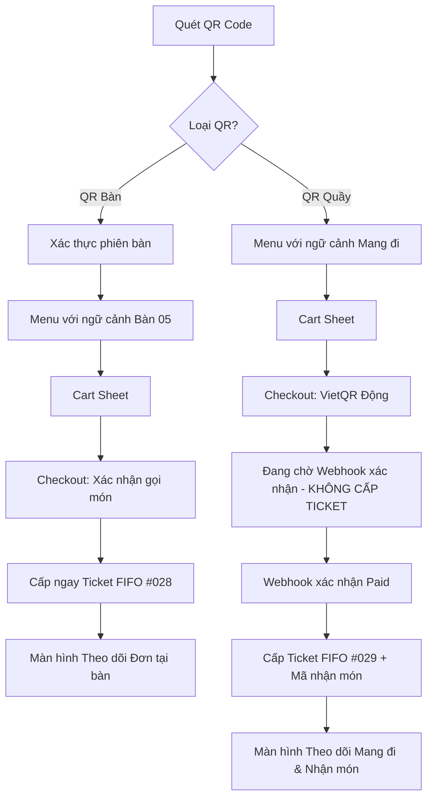

# WIREFRAMES — QR Ordering Minimal MVP

> **Phiên bản:** 1.0 · **Ngày:** 23/10/2026  
> **Tác giả:** Senior Product Designer + UI Engineer (Gemini)  
> **Tiêu chuẩn thiết bị:** Mobile 375–430px (Khách hàng), Tablet 768px & Desktop 1024–1440px (Chủ quán)  
> **Nguồn tham chiếu:** `assets/ui-reference.png`, `UI.md`, `PRD.md`, `ARCHITECTURE.md`

---

# PHẦN 1: GIAO DIỆN KHÁCH HÀNG (CUSTOMER MOBILE-FIRST: 375PX – 430PX)



---

## 1.1 Giao diện Menu & Header Ngữ cảnh QR (Mobile 375px)

### [A] Chế độ Tại Bàn (Dine-in) vs [B] Chế độ Mang Đi (Takeaway)

```text
┌────────────────────────────────────────────────────────┐
│  TIỆM CÀ PHÊ MỘC                      [ 🛒 Giỏ (2) ]  │ ← Header cố định (h-14)
│  📍 Bàn 05 · Mã phiên: #8821                           │ ← Ngữ cảnh phiên rõ ràng
│  Chào bạn! Chọn món ngon để quán phục vụ nhé.          │
├────────────────────────────────────────────────────────┤
│  🔍 [ Tìm món ăn, thức uống...                      ] │ ← Input tìm kiếm bo góc 12px
│                                                        │
│  ( Tất cả )  [ Cà phê ]  [ Trà sữa ]  [ Trà trái cây ] │ ← Chips danh mục cuộn ngang
├────────────────────────────────────────────────────────┤
│  CÀ PHÊ (Đang hiển thị 4 món)                          │
│                                                        │
│  ┌───────────┐  Cà phê muối xứ Huế                     │
│  │           │  Cà phê Robusta thơm đậm cùng lớp kem   │
│  │   [Ảnh]   │  muối béo ngậy đặc trưng.               │
│  │           │  35.000 đ                               │
│  │           │  [ + Thêm ]                             │ ← Nút CTA món (h-9, bo 10px)
│  └───────────┘─────────────────────────────────────────│
│  ┌───────────┐  Bạc xỉu ba tầng                        │
│  │   [Ảnh]   │  Sữa đặc, sữa tươi và cà phê phối lớp.  │
│  │           │  32.000 đ                               │
│  │           │  [ + Thêm ]                             │
│  └───────────┘─────────────────────────────────────────│
│  ┌───────────┐  Cà phê cốt dừa đá xay                  │
│  │   [Ảnh]   │  [ Hết hàng ] · Tạm ngưng phục vụ       │ ← Badge xám mờ disabled
│  │   (Mờ)    │  45.000 đ                               │
│  │           │  [ Hết món ] (Disabled)                 │
│  └───────────┘─────────────────────────────────────────│
├────────────────────────────────────────────────────────┤
│  [  🛒 2 món · 67.000 đ                  Xem giỏ →  ]  │ ← Sticky Cart Bar (h-14, #1D725E)
└────────────────────────────────────────────────────────┘
```

> **Lý do UX:** Khách hàng thấy ngay số bàn hoặc chế độ mang đi trên đầu trang để an tâm không bị nhầm bàn. Danh mục dạng viên thuốc (Pill chips) kế thừa trực tiếp từ ảnh mẫu POS, cuộn ngang bằng ngón tay cái cực kỳ tiện lợi trên màn hình 375px.

---

## 1.2 Cart Sheet (Ngăn kéo Giỏ hàng trượt từ dưới lên)

```text
┌────────────────────────────────────────────────────────┐
│                        ─────                           │ ← Thanh gạt Sheet handle
│  GIỎ HÀNG CỦA BẠN (2 món)                     [Đóng ✕] │
├────────────────────────────────────────────────────────┤
│  1. Cà phê muối xứ Huế                       35.000 đ  │
│     - Tùy chọn: Ít ngọt (70%), Nhiều đá                │
│     - Ghi chú: "Cho kem muối riêng giúp mình"          │
│     Thao tác: [ - ]  1  [ + ]               [Xóa 🗑️]   │ ← Nút - / + vùng chạm 36x36px
├────────────────────────────────────────────────────────┤
│  2. Trà đào cam sả                           32.000 đ  │
│     - Tùy chọn: Mặc định                               │
│     Thao tác: [ - ]  1  [ + ]               [Xóa 🗑️]   │
├────────────────────────────────────────────────────────┤
│  📝 Ghi chú chung cho quán:                            │
│  [ Xin thêm 1 ly nước lọc đá...                      ] │ ← Textarea ngắn gọn
├────────────────────────────────────────────────────────┤
│  Tạm tính (2 món):                           67.000 đ  │
│  Phí dịch vụ:                                     0 đ  │
│  TỔNG CỘNG:                                  67.000 đ  │
├────────────────────────────────────────────────────────┤
│  [ TIẾP TỤC ĐẶT HÀNG — 67.000 đ                      ] │ ← CTA Primary (#1D725E, h-12)
└────────────────────────────────────────────────────────┘
```

> **Lý do UX:** Cart hiển thị dạng Bottom Sheet thay vì chuyển trang giúp khách không mất ngữ cảnh món ăn đang duyệt. Các nút điều chỉnh số lượng to bản rõ ràng, tránh chạm nhầm nút xóa.

---

## 1.3 Checkout Bước 1: Dine-in (Gọi món tại bàn)

```text
┌────────────────────────────────────────────────────────┐
│  ← Quay lại giỏ hàng                 XÁC NHẬN GỌI MÓN  │
├────────────────────────────────────────────────────────┤
│  THÔNG TIN BÀN PHỤC VỤ                                 │
│  ┌──────────────────────────────────────────────────┐  │
│  │ 📍 Vị trí: BÀN 05                                │  │
│  │ Mã phiên: #8821 · Trạng thái: Đang mở            │  │
│  │ Hình thức: Phục vụ tại bàn (Trả tiền sau)        │  │
│  └──────────────────────────────────────────────────┘  │
│                                                        │
│  TÓM TẮT ĐƠN HÀNG                                      │
│  • 1x Cà phê muối xứ Huế                     35.000 đ  │
│  • 1x Trà đào cam sả                         32.000 đ  │
│  Tổng thanh toán tạm tính:                   67.000 đ  │
│                                                        │
│  ℹ️ Lưu ý: Quán sẽ bắt đầu làm món ngay sau khi bạn    │
│     xác nhận. Hóa đơn sẽ được gộp vào bàn của bạn.     │
├────────────────────────────────────────────────────────┤
│  [  XÁC NHẬN GỌI MÓN (CẤP TICKET NGAY)               ] │ ← Primary CTA (#1D725E)
└────────────────────────────────────────────────────────┘
```

> **Lý do UX:** Với Dine-in, khách không cần thanh toán trước. Màn hình chỉ tóm tắt đúng 3 thông tin trọng yếu: Số bàn, món đã chọn và cam kết thanh toán cuối phiên. Nhấn xác nhận là tạo đơn và nhận ticket FIFO ngay lập tức.

---

## 1.4 Checkout Bước 2: Takeaway (VietQR Động & Chờ Webhook Xác Nhận)

```text
┌────────────────────────────────────────────────────────┐
│  ← Hủy đơn                        THANH TOÁN MANG ĐI   │
├────────────────────────────────────────────────────────┤
│  ĐƠN HÀNG MANG ĐI (TAKEAWAY)                           │
│  Số tiền: 67.000 đ · Mã tham chiếu: MOC-TK029          │
│                                                        │
│  ┌──────────────────────────────────────────────────┐  │
│  │              MÃ VIETQR TỰ ĐỘNG                   │  │
│  │            ┌────────────────────┐                │  │
│  │            │  ████  ██  ████    │                │  │
│  │            │  ████  ██  ████    │                │  │
│  │            │      VietQR        │                │  │
│  │            │  ████  ██  ████    │                │  │
│  │            └────────────────────┘                │  │
│  │  Chủ TK: NGUYEN VAN A · STK: 1903...             │  │
│  │  Ngân hàng: MBBank · Nội dung: MOC-TK029         │  │
│  │  [ Sao chép STK ]       [ Tải mã QR ]            │  │
│  └──────────────────────────────────────────────────┘  │
│                                                        │
│  ⏱️ Mã thanh toán có hiệu lực trong: 14:42             │
│                                                        │
│  ⚠️ CẢNH BÁO QUAN TRỌNG:                               │
│  ┌──────────────────────────────────────────────────┐  │
│  │ ⏳ Đang chờ ngân hàng xác nhận giao dịch...      │  │ ← Pulse Animation
│  │ Vui lòng KHÔNG chuyển khoản lần hai nếu bạn      │  │
│  │ đã thực hiện chuyển tiền thành công trên App!     │  │
│  └──────────────────────────────────────────────────┘  │
│                                                        │
│  [ 🔄 Đang tự động kiểm tra... (Không tắt trang) ]     │ ← Disabled Button (Pending)
└────────────────────────────────────────────────────────┘
```

> **Lý do UX:** Tuyệt đối không sinh số ticket ở bước này! Đơn hàng đang ở trạng thái `pending_payment`. UI hiển thị đồng hồ đếm ngược và thông điệp cảnh báo màu hổ phách `#A76200` để khách không bị hoang mang chuyển khoản trùng lặp khi mạng chậm.

---

## 1.5 Màn hình Theo dõi Đơn hàng (Order Tracking)

### [A] Tracking Dine-in (Tại bàn) vs [B] Tracking Takeaway (Mang đi có Mã nhận)

```text
┌────────────────────────────────────────────────────────┐
│  TIỆM CÀ PHÊ MỘC                      [ Cần hỗ trợ 💬] │
├────────────────────────────────────────────────────────┤
│                                                        │
│             SỐ THỨ TỰ PHỤC VỤ (FIFO)                   │
│                    #028                                │ ← Ticket hiển thị cực lớn (28px Bold)
│                                                        │
│  📍 Tại bàn: BÀN 05        ⏱️ Thời gian đặt: 14:28     │
│  (Hoặc: 🛍️ Mua mang đi · Đã thanh toán)                │
├────────────────────────────────────────────────────────┤
│  TIẾN TRÌNH CHẾ BIẾN:                                  │
│                                                        │
│  (✓) Đã nhận đơn                                       │
│   │                                                    │
│  (●) ĐANG LÀM MÓN  ─── [ Quán đang pha chế đơn của bạn]│ ← Trạng thái Info (#2563A6)
│   │                                                    │
│  ( ) Sẵn sàng phục vụ                                  │
│   │                                                    │
│  ( ) Đã giao đến bàn                                   │
├────────────────────────────────────────────────────────┤
│  [ DÀNH RIÊNG CHO ĐƠN TAKEAWAY ]                       │
│  ┌──────────────────────────────────────────────────┐  │
│  │  🔑 MÃ XÁC MINH NHẬN MÓN: TK-8821                │  │ ← Opaque guest access token
│  │  Vui lòng đọc mã này cho nhân viên tại quầy      │  │
│  │  khi nhận đồ uống. Không chia sẻ mã này.         │  │
│  └──────────────────────────────────────────────────┘  │
├────────────────────────────────────────────────────────┤
│  CHI TIẾT MÓN:                                         │
│  • 1x Cà phê muối xứ Huế · Ít ngọt                     │
│  • 1x Trà đào cam sả · Mặc định                        │
├────────────────────────────────────────────────────────┤
│  [ + GỌI THÊM MÓN CHO BÀN NÀY ]                        │ ← Nút gọi thêm (chỉ hiện cho Dine-in)
└────────────────────────────────────────────────────────┘
```

> **Lý do UX:** Khách nhìn thấy số Ticket lớn rõ ràng để chủ động theo dõi âm thanh gọi số của quán. Mã xác minh nhận món Takeaway (`TK-8821`) chỉ xuất hiện trên thiết bị của người mua (bảo vệ bởi guest token), đảm bảo không ai lấy nhầm đồ.

---

## 1.6 Các Trạng thái Ngoại lệ & Màn hình Lỗi của Customer

### [A] Phiên bàn hết hạn (`SESSION_EXPIRED`)
```text
┌────────────────────────────────────────────────────────┐
│                        ⚠️                              │
│              PHIÊN BÀN KHÔNG HIỆU LỰC                  │
│                                                        │
│  Phiên phục vụ của Bàn 05 đã được đóng hoặc mã QR      │
│  đã hết hạn.                                           │
│                                                        │
│  Vui lòng liên hệ nhân viên tại quầy để được mở phiên   │
│  mới hoặc quét lại mã QR tại bàn.                      │
│                                                        │
│  [ Quét lại mã QR ]            [ Gọi nhân viên hỗ trợ ]│
└────────────────────────────────────────────────────────┘
```

### [B] Món hết hàng lúc đặt (`OUT_OF_STOCK`)
```text
┌────────────────────────────────────────────────────────┐
│                        ⚠️                              │
│             MÓN ĂN VỪA HẾT HÀNG                        │
│                                                        │
│  Rất tiếc! Món "Cà phê cốt dừa" vừa hết trong lúc bạn   │
│  chọn món. Các món còn lại vẫn được giữ trong giỏ.     │
│                                                        │
│  [ Điều chỉnh lại giỏ hàng ]                           │
└────────────────────────────────────────────────────────┘
```

### [C] Mất kết nối mạng (`NETWORK_OFFLINE`)
```text
┌────────────────────────────────────────────────────────┐
│ 🔴 Đang mất kết nối Internet. Đang thử kết nối lại...  │ ← Banner ghim đỉnh màn hình
└────────────────────────────────────────────────────────┘
```

### [D] Giỏ hàng trống (`EMPTY_CART`)
```text
┌────────────────────────────────────────────────────────┐
│                        🛒                              │
│              GIỎ HÀNG ĐANG TRỐNG                       │
│  Bạn chưa chọn món nào. Hãy dạo quanh menu để chọn món │
│  ngon nhé!                                             │
│                                                        │
│  [ Khám phá menu quán ngay ]                           │
└────────────────────────────────────────────────────────┘
```

---

# PHẦN 2: GIAO DIỆN CHỦ QUÁN (OWNER DASHBOARD: 1024PX – 1440PX)

## 2.1 Bố cục Shell Tổng thể Desktop (Tỷ lệ 70/30 chuẩn hình mẫu)

```text
┌─────────────────────────────────────────────────────────────────────────────────────────────────────────┐
│ [Logo] TIỆM CÀ PHÊ MỘC      [ (Đơn hàng) ]  [ Bàn ]  [ Menu ]  [ Cài đặt ]     [Sania - Chủ quán · 🚪]  │ ← Header Pill Nav
├───────────────────────────────────────────────────────────────────┬─────────────────────────────────────┤
│  CỘT TRÁI: HÀNG ĐỢI ĐƠN HÀNG (~70% CHIỀU RỘNG)                    │ CỘT PHẢI: CHI TIẾT ĐƠN (~30%)       │
│                                                                   │                                     │
│  [ TỔNG QUAN:  Chờ làm (4)  ·  Đang làm (2)  ·  Sẵn sàng (1) ]    │ CHI TIẾT ĐƠN HÀNG                   │
│                                                                   │                                     │
│  Lọc: ( Tất cả )  [ Tại bàn ]  [ Mang đi ]                        │ ĐƠN #028 · Mang đi                  │
│                                                                   │ ⏱️ Nhận lúc: 14:28 (4 phút trước)    │
│  ┌─────────────────────────────────────────────────────────────┐  │ Trạng thái: Đang làm món            │
│  │ ★ THAO TÁC FIFO CHÍNH:                                      │  │ Thanh toán: [ Đã trả - VietQR ]     │
│  │ [ ▶ NHẬN ĐƠN TIẾP THEO (TỰ ĐỘNG CHỌN ĐƠN CŨ NHẤT)         ] │  ├─────────────────────────────────────┤
│  └─────────────────────────────────────────────────────────────┘  │ DANH SÁCH MÓN:                      │
│                                                                   │ • 2x Trà sữa trân châu hoàng kim    │
│  DANH SÁCH ĐƠN ĐANG XỬ LÝ (Sắp xếp theo thứ tự Ticket FIFO):      │   - 50% đường, 70% đá               │
│                                                                   │ • 1x Bánh sừng bò phô mai           │
│  ┌─────────────────────────────────────────────────────────────┐  │                                     │
│  │ #028  ·  Mang đi  ·  3 món  ·  115.000 đ                    │  │ GHI CHÚ TỪ KHÁCH:                   │
│  │ [ Đang làm món ]   Bắt đầu: 14:30   (Đang chọn xem) ◄       │  │ "Giao kèm ống hút giấy giúp mình"   │
│  └─────────────────────────────────────────────────────────────┘  ├─────────────────────────────────────┤
│  ┌─────────────────────────────────────────────────────────────┐  │ HÀNH ĐỘNG HỢP LỆ:                   │
│  │ #029  ·  Bàn 03   ·  2 món  ·  67.000 đ                     │  │ [ ✓ ĐÁNH DẤU SẴN SÀNG ]             │
│  │ [ Chờ làm món ]   Đợi: 5 phút trước                         │  │                                     │
│  └─────────────────────────────────────────────────────────────┘  │ Mã nhận (đối soát khi giao):        │
│  ┌─────────────────────────────────────────────────────────────┐  │ [ TK-8821                          ]│
│  │ #030  ·  Mang đi  ·  1 món  ·  35.000 đ                     │  │ [ 🛵 ĐÃ GIAO / HOÀN TẤT ĐƠN ]       │
│  │ [ Chờ làm món ]   Đợi: 3 phút trước                         │  │                                     │
│  └─────────────────────────────────────────────────────────────┘  │ ─────────────────────────────────── │
│  ┌─────────────────────────────────────────────────────────────┐  │ [ ⚠️ Hủy đơn ngoại lệ / Hoàn tiền ] │
│  │ #027  ·  Bàn 01   ·  4 món  ·  152.000 đ                    │  │                                     │
│  │ [ Sẵn sàng ]      Chờ mang ra bàn                           │  │                                     │
│  └─────────────────────────────────────────────────────────────┘  │                                     │
└───────────────────────────────────────────────────────────────────┴─────────────────────────────────────┘
```

> **QUY TẮC FIFO TRONG THIẾT KẾ UI:**  
> Không bao giờ bố trí các nút "Bắt đầu làm" tùy tiện trên từng thẻ đơn trong danh sách. Nếu chủ quán bấm tùy tiện, thứ tự phục vụ công bằng sẽ bị phá vỡ.  
> UI chỉ cung cấp **1 nút chính duy nhất: [ ▶ Nhận đơn tiếp theo ]** gọi atomic API `POST /api/owner/queue/claim-next`. Server sẽ khóa DB transaction và chọn chính xác đơn `accepted` có ticket nhỏ nhất còn tồn đọng.

---

## 2.2 Tab 2 — Quản lý Bàn (Tables Tab)

```text
┌─────────────────────────────────────────────────────────────────────────────────────────────────────────┐
│ [Logo] TIỆM CÀ PHÊ MỘC      [ Đơn hàng ]  [ (Bàn) ]  [ Menu ]  [ Cài đặt ]     [Sania - Chủ quán · 🚪]  │
├───────────────────────────────────────────────────────────────────┬─────────────────────────────────────┤
│  CỘT TRÁI: LƯỚI DANH SÁCH BÀN PHỤC VỤ (Không kéo thả)             │ CỘT PHẢI: CHI TIẾT PHIÊN BÀN        │
│                                                                   │                                     │
│  Lọc: ( Tất cả 12 bàn )  [ Có khách: 4 ]  [ Đang trống: 8 ]       │ THÔNG TIN BÀN: BÀN 05               │
│                                                                   │ Trạng thái: Đang có khách           │
│  ┌───────────────┐ ┌───────────────┐ ┌───────────────┐            │ Mã phiên hiện tại: #8821            │
│  │ BÀN 01        │ │ BÀN 02        │ │ BÀN 03        │            │ Thời gian mở: 13:45 (55 phút trước) │
│  │ 🟢 Đang ngồi  │ │ ⚪ Trống      │ │ 🟡 Chờ tính   │            ├─────────────────────────────────────┤
│  │ 2 đơn · 185k  │ │ [ Mở phiên ]  │ │ 3 đơn · 320k  │            │ CÁC ĐƠN HÀNG TRONG PHIÊN:           │
│  └───────────────┘ └───────────────┘ └───────────────┘            │ • Đơn #021 (Đã giao)       115.000 đ│
│  ┌───────────────┐ ┌───────────────┐ ┌───────────────┐            │ • Đơn #029 (Đang làm)       70.000 đ│
│  │ BÀN 04        │ │ BÀN 05 (Chọn) │ │ BÀN 06        │            ├─────────────────────────────────────┤
│  │ ⚪ Trống      │ │ 🟢 Đang ngồi  │ │ ⚪ Trống      │            │ TỔNG KẾT PHIÊN BÀN:                 │
│  │ [ Mở phiên ]  │ │ 2 đơn · 185k  │ │ [ Mở phiên ]  │            │ Tổng tiền tạm tính:        185.000 đ│
│  └───────────────┘ └───────────────┘ └───────────────┘            ├─────────────────────────────────────┤
│                                                                   │ HÌNH THỨC THU TIỀN:                 │
│  (Hiển thị dạng Grid thẻ hình chữ nhật sạch sẽ, không sơ đồ floor) │ (●) Tiền mặt    ( ) Chuyển khoản    │
│                                                                   │                                     │
│                                                                   │ [ 💳 XÁC NHẬN ĐÃ THU & ĐÓNG BÀN ]   │
│                                                                   │ [ 🖨️ In hóa đơn tạm tính ]          │
└───────────────────────────────────────────────────────────────────┴─────────────────────────────────────┘
```

> **Lý do UX:** Giữ giao diện dạng Card Grid trực quan, loại bỏ hoàn toàn sơ đồ floorplan kéo thả phức tạp không cần thiết cho quán quy mô nhỏ. Chủ quán có thể mở phiên mới hoặc quyết toán đóng bàn chỉ với 2 lần chạm.

---

## 2.3 Tab 3 — Quản lý Thực đơn (Menu Tab)

```text
┌─────────────────────────────────────────────────────────────────────────────────────────────────────────┐
│ [Logo] TIỆM CÀ PHÊ MỘC      [ Đơn hàng ]  [ Bàn ]  [ (Menu) ]  [ Cài đặt ]     [Sania - Chủ quán · 🚪]  │
├───────────────────────────────────────────────────────────────────┬─────────────────────────────────────┤
│  CỘT TRÁI: DANH SÁCH MÓN ĂN                                       │ CỘT PHẢI: CHỈNH SỬA / THÊM MÓN      │
│                                                                   │                                     │
│  🔍 [ Tìm tên món trong menu...               ]  [+ Thêm món]     │ CHỈNH SỬA MÓN ĂN                    │
│                                                                   │                                     │
│  CÀ PHÊ (4 món)                                                   │ Tên món:                            │
│  ┌─────────────────────────────────────────────────────────────┐  │ [ Cà phê cốt dừa đá xay           ] │
│  │ [Ảnh] Cà phê muối xứ Huế               35.000 đ             │  │                                     │
│  │       Trạng thái: [ Còn hàng 🟢 ]     [✏️ Sửa]              │  │ Danh mục:                           │
│  └─────────────────────────────────────────────────────────────┘  │ [ Cà phê                        ▼ ] │
│  ┌─────────────────────────────────────────────────────────────┐  │                                     │
│  │ [Ảnh] Bạc xỉu ba tầng                  32.000 đ             │  │ Giá bán (VND):                      │
│  │       Trạng thái: [ Còn hàng 🟢 ]     [✏️ Sửa]              │  │ [ 45.000                       ]     │
│  └─────────────────────────────────────────────────────────────┘  │                                     │
│  ┌─────────────────────────────────────────────────────────────┐  │ Trạng thái kinh doanh:              │
│  │ [Ảnh] Cà phê cốt dừa đá xay            45.000 đ             │  │ [ Switch ON: Còn phục vụ          ] │
│  │       Trạng thái: [ HẾT HÀNG 🔴 ]     [✏️ Sửa (Đang chọn)]  │  │                                     │
│  └─────────────────────────────────────────────────────────────┘  │ Ảnh món:                            │
│                                                                   │ [ Khung preview ảnh ] [ Đổi ảnh 📁 ]│
│  TRÀ TRÁI CÂY (6 món)                                             ├─────────────────────────────────────┤
│  ┌─────────────────────────────────────────────────────────────┐  │ [ LƯU THAY ĐỔI MÓN ]                │
│  │ [Ảnh] Trà đào cam sả                   32.000 đ             │  │ [ Tạm ngưng bán món này ]           │
│  │       Trạng thái: [ Còn hàng 🟢 ]     [✏️ Sửa]              │  │                                     │
│  └─────────────────────────────────────────────────────────────┘  │                                     │
└───────────────────────────────────────────────────────────────────┴─────────────────────────────────────┘
```

> **Lý do UX:** Công tắc bật/tắt Còn hàng / Hết hàng ngay tại danh sách món giúp chủ quán cập nhật trạng thái kho tức thì chỉ với 1 click khi đông khách, ngăn chặn khách đặt phải món đã hết nguyên liệu.

---

## 2.4 Tab 4 — Cài đặt Hệ thống (Settings Tab)

```text
┌─────────────────────────────────────────────────────────────────────────────────────────────────────────┐
│ [Logo] TIỆM CÀ PHÊ MỘC      [ Đơn hàng ]  [ Bàn ]  [ Menu ]  [ (Cài đặt) ]     [Sania - Chủ quán · 🚪]  │
├─────────────────────────────────────────────────────────────────────────────────────────────────────────┤
│  THIẾT LẬP CỬA HÀNG & HỆ THỐNG VẬN HÀNH                                                                 │
│                                                                                                         │
│  ┌───────────────────────────────────────────────────────────────────────────────────────────────────┐  │
│  │ 1. TRẠNG THÁI HOẠT ĐỘNG CỦA QUÁN                                                                  │  │
│  │ Trạng thái hiện tại: [ ĐANG MỞ CỬA NHẬN ĐƠN (Switch ON) ]                                         │  │
│  │ (Khi tắt, khách quét QR sẽ nhận thông báo quán tạm ngưng phục vụ)                                 │  │
│  └───────────────────────────────────────────────────────────────────────────────────────────────────┘  │
│  ┌───────────────────────────────────────────────────────────────────────────────────────────────────┐  │
│  │ 2. THÔNG TIN QUÁN ĂN / QUÁN CÀ PHÊ                                                                │  │
│  │ Tên quán:    [ Tiệm Cà Phê Mộc                                            ]                       │  │
│  │ Địa chỉ:     [ 123 Đường Hoa Hồng, Phường 2, Quận Phú Nhuận, TP.HCM       ]                       │  │
│  │ Múi giờ:     [ Asia/Ho_Chi_Minh (Mặc định chuẩn)                          ]                       │  │
│  └───────────────────────────────────────────────────────────────────────────────────────────────────┘  │
│  ┌───────────────────────────────────────────────────────────────────────────────────────────────────┐  │
│  │ 3. QUẢN LÝ MÃ QR BÀN & QUẦY                                                                       │  │
│  │ • QR Mang đi tại quầy:  [ Xem mã QR ]   [ Tải file in chất lượng cao ]                            │  │
│  │ • QR Phục vụ tại bàn:   [ Tải trọn bộ QR 12 bàn (PDF sẵn sàng in) ]                               │  │
│  └───────────────────────────────────────────────────────────────────────────────────────────────────┘  │
│  ┌───────────────────────────────────────────────────────────────────────────────────────────────────┐  │
│  │ 4. TÍCH HỢP CỔNG THANH TOÁN TỰ ĐỘNG (Metadata - Tuyệt đối không hiển thị Secret Keys)            │  │
│  │ Cổng thanh toán:  VietQR (payOS / SePay Adapter)                                                  │  │
│  │ Trạng thái kết nối Webhook: 🟢 Đã kết nối thành công (Lần nhận cuối: 2 phút trước)                │  │
│  │ [ Kiểm tra lại kết nối Webhook ]                                                                  │  │
│  └───────────────────────────────────────────────────────────────────────────────────────────────────┘  │
│  ┌───────────────────────────────────────────────────────────────────────────────────────────────────┐  │
│  │ 5. ĐỐI SOÁT THANH TOÁN NGOẠI LỆ (Payment Exceptions)                                             │  │
│  │ Hiện không có giao dịch nào bất thường hoặc chuyển khoản trễ hạn.                                  │  │
│  │ [ Xem lịch sử đối soát giao dịch ]                                                                │  │
│  └───────────────────────────────────────────────────────────────────────────────────────────────────┘  │
└─────────────────────────────────────────────────────────────────────────────────────────────────────────┘
```

> **Lý do UX:** Tinh gọn toàn bộ thiết lập vào 1 trang duy nhất, nhóm theo khối thông tin mạch lạc. Không tạo các trang tài chính kế toán phức tạp. Đảm bảo an toàn thông tin: không bao giờ để lộ API Key/Secret của cổng thanh toán trên giao diện.

---

## 2.5 Responsive Owner trên Tablet (768px) và Mobile (375px)

```text
┌──────────────────────────────────────────┐
│  TIỆM CÀ PHÊ MỘC          [ 🔔 2 ] [ 🚪 ]│
│  [ (Đơn) ]   [ Bàn ]   [ Menu ]   [ Cài ]│ ← Tabs cuộn ngang gọn gàng (h-11)
├──────────────────────────────────────────┤
│  Chờ làm (4) · Đang làm (2) · Sẵn sàng(1)│
│                                          │
│  [ ▶ NHẬN ĐƠN TIẾP THEO (FIFO) ]         │ ← Nút lớn chiếm trọn chiều ngang (h-12)
├──────────────────────────────────────────┤
│  DANH SÁCH ĐƠN HÀNG:                     │
│                                          │
│  ┌────────────────────────────────────┐  │
│  │ #028 · Mang đi · 3 món · 115.000 đ │  │
│  │ [ Đang làm ]  ⏱️ 4 phút trước       │  │
│  │ [ Xem chi tiết đơn & Giao hàng → ] │  │ ← Bấm vào sẽ mở Bottom Sheet
│  └────────────────────────────────────┘  │
│  ┌────────────────────────────────────┐  │
│  │ #029 · Bàn 03 · 2 món · 67.000 đ   │  │
│  │ [ Chờ làm ]   ⏱️ 5 phút trước       │  │
│  │ [ Xem chi tiết đơn → ]             │  │
│  └────────────────────────────────────┘  │
└──────────────────────────────────────────┘
```

```text
┌──────────────────────────────────────────┐
│                   ─────                  │ ← Sheet chi tiết đơn trượt lên trên Tablet/Mobile
│  CHI TIẾT ĐƠN #028 · Mang đi    [Đóng ✕] │
├──────────────────────────────────────────┤
│  • 2x Trà sữa trân châu hoàng kim        │
│  • 1x Bánh sừng bò phô mai               │
│  Ghi chú: "Giao kèm ống hút giấy"        │
│  Thanh toán: [ Đã trả VietQR ]           │
├──────────────────────────────────────────┤
│  [ ✓ ĐÁNH DẤU SẴN SÀNG ]                 │
│  Mã nhận món đối chiếu: [ TK-8821 ]      │
│  [ 🛵 XÁC MINH & ĐÃ GIAO ]               │
└──────────────────────────────────────────┘
```

> **Lý do UX:** Trên màn hình tablet hoặc điện thoại của chủ quán, tỷ lệ 70/30 tự động chuyển sang 1 cột danh sách duy nhất. Chi tiết đơn được hiển thị tức thì qua Bottom Sheet trượt mở êm ái, đảm bảo vùng chạm cực kỳ rộng rãi (h-12) khi thao tác bằng ngón tay.
